# ỨNG DỤNG HỌC SÂU NHẬN DẠNG VÀ TRÍCH XUẤT THÔNG TIN TỰ ĐỘNG TỪ THẺ CĂN CƯỚC CÔNG DÂN VIỆT NAM

> **DỰ ÁN TỐT NGHIỆP CAPSTONE PROJECT — SAMSUNG INNOVATION CAMPUS (SIC)**  
> **Khóa đào tạo:** Trí tuệ Nhân tạo (Artificial Intelligence Course)  
> **Đơn vị thực hiện:** Nhóm 8 — AI Innovation Team  
> **Thời gian hoàn thành:** Tháng 10/2026  

[](#hướng-dẫn-cài-đặt-và-khởi-chạy)
[](https://www.python.org/)
[](https://fastapi.tiangolo.com/)
[](#đường-ống-xử-lý-và-mô-hình-ai)
[-003B57.svg)](#quản-lý-dữ-liệu-và-cơ-chế-kiểm-duyệt)
[-success.svg)](#kết-quả-thực-nghiệm-và-kiểm-thử)
[](#cam-kết-an-toàn-thông-tin-và-bảo-mật)

---

## MỤC LỤC
1. [Giới thiệu bài toán và Tính cấp thiết](#1-giới-thiệu-bài-toán-và-tính-cấp-thiết)
2. [Đội ngũ thực hiện và Phân công nhiệm vụ](#2-đội-ngũ-thực-hiện-và-phân-công-nhiệm-vụ)
3. [Kiến trúc hệ thống tổng thể](#3-kiến-trúc-hệ-thống-tổng-thể)
4. [Đường ống xử lý và Mô hình AI](#4-đường-ống-xử-lý-và-mô-hình-ai)
5. [Hệ chuyên gia bóc tách Heuristics tiếng Việt](#5-hệ-chuyên-gia-bóc-tách-heuristics-tiếng-việt)
6. [Quản lý dữ liệu và Cơ chế kiểm duyệt Human-in-the-Loop](#6-quản-lý-dữ-liệu-và-cơ-chế-kiểm-duyệt-human-in-the-loop)
7. [Kết quả thực nghiệm và Kiểm thử](#7-kết-quả-thực-nghiệm-và-kiểm-thử)
8. [Cấu trúc mã nguồn dự án](#8-cấu-trúc-mã-nguồn-dự-án)
9. [Hướng dẫn cài đặt và Khởi chạy](#9-hướng-dẫn-cài-đặt-và-khởi-chạy)
10. [Cam kết an toàn thông tin và Bảo mật](#10-cam-kết-an-toàn-thông-tin-và-bảo-mật)
11. [Tài liệu tham khảo và Lời cảm ơn](#11-tài-liệu-tham-khảo-và-lời-cảm-ơn)

---

## 1. GIỚI THIỆU BÀI TOÁN VÀ TÍNH CẤP THIẾT

Trong bối cảnh đẩy mạnh chuyển đổi số quốc gia và triển khai Đề án 06 của Chính phủ, quy trình định danh điện tử (eKYC) và xác minh danh tính công dân đã trở thành mắt xích đầu tiên mang tính bắt buộc tại các ngân hàng thương mại, tổ chức tín dụng, cơ quan hành chính công, doanh nghiệp viễn thông và cơ sở dịch vụ lưu trú.

Tuy nhiên, tại phần lớn các điểm giao dịch hiện nay, khâu tiếp nhận thông tin khách hàng vẫn phụ thuộc nặng nề vào việc cán bộ nhập liệu thủ công bằng mắt và bàn phím:
- **Tốn kém thời gian:** Trung bình mất từ 2 đến 3 phút để một nhân viên nhập đầy đủ họ tên, ngày sinh, quê quán, nơi thường trú và 12 chữ số định danh cá nhân.
- **Tỉ lệ sai sót cao:** Tên địa giới hành chính tiếng Việt phức tạp với nhiều thanh dấu (hỏi, ngã, nặng) cùng các dãy số dài rất dễ bị nhầm lẫn trong quá trình gõ vội dưới áp lực giao dịch giờ cao điểm.
- **Rủi ro lộ lọt dữ liệu từ Cloud OCR:** Các giải pháp nhận diện đám mây thương mại hiện hành đòi hỏi phải truyền tải hình ảnh giấy tờ tùy thân của công dân lên máy chủ từ xa, tiềm ẩn nguy cơ mất an toàn thông tin đời tư nghiêm trọng và phát sinh chi phí duy trì bản quyền đắt đỏ theo từng lượt quét.

**Giải pháp của nhóm nghiên cứu:**  
Chúng em phát triển hệ thống **AI OCR chuyên dụng cho thẻ Căn cước công dân Việt Nam** (hỗ trợ cả CCCD gắn chip, CCCD mã vạch và CMND 9/12 số) vận hành **hoàn toàn cục bộ (100% Offline On-Premise)** trên máy tính cá nhân. Hệ thống tự động thu nhận ảnh qua Webcam hoặc tệp quét, cắt nắn góc nghiêng, tăng cường độ nét, nhận dạng ký tự bằng mô hình Học sâu hiện đại và áp dụng hệ chuyên gia Heuristics để bóc tách chính xác từng trường dữ liệu có cấu trúc với thời gian phản hồi chỉ **~1.7 giây** trên phần cứng máy tính thông thường.

---

## 2. ĐỘI NGŨ THỰC HIỆN VÀ PHÂN CÔNG NHIỆM VỤ

Dự án được xây dựng bởi tập thể sinh viên **Nhóm 8 — AI Innovation Team** dưới sự hướng dẫn chuyên môn từ các giảng viên chương trình Samsung Innovation Campus:

| STT | Thành viên | Vai trò đảm nhiệm | Nhiệm vụ kỹ thuật chính |
|:---:|:---|:---|:---|
| **1** | **Lê Minh Tú** | **Trưởng nhóm**<br>Kỹ sư AI & Backend | Thiết kế kiến trúc tổng thể; Tối ưu hóa mô hình suy luận Deep Learning (Singleton Pattern, CPU Threadpool); Xây dựng máy chủ FastAPI và thiết kế RESTful API. |
| **2** | **Nguyễn Kim Nhàn** | Kỹ sư Tiền xử lý<br>& Thị giác máy tính | Nghiên cứu và hiện thực thuật toán phát hiện viền thẻ 4 góc, biến đổi phối cảnh nắn phẳng (Perspective Transform); Bộ lọc tăng cường tương phản CLAHE và Unsharp Masking. |
| **3** | **Trịnh Thùy Linh** | Kỹ sư Thuật toán<br>& Khai phá dữ liệu | Xây dựng bộ luật Heuristics ngữ nghĩa tiếng Việt; Thuật toán phân định đa ngày tháng (Multi-date); Khớp mờ từ điển 63 tỉnh/thành phố và phân tích giải mã 12 số định danh. |
| **4** | **Tống Bảo Ngọc** | Kỹ sư Giao diện<br>& Trải nghiệm người dùng | Thiết kế giao diện Web Responsive tương tác cao (Vanilla HTML5/CSS3/JavaScript); Cơ chế chụp Webcam 2 giai đoạn (Capture & Review); Trực quan hóa Bounding Box đồng bộ. |
| **5** | **Trương Tiến Đạt** | Kỹ sư Đảm bảo chất lượng<br>& Vận hành hệ thống | Xây dựng bộ kiểm thử tự động (Automated Test Suite); Thiết kế cơ sở dữ liệu SQLite tối ưu chế độ WAL chống khóa tiến trình; Đóng gói ứng dụng chạy 1-click Windows EXE và Linux Docker. |

---

## 3. KIẾN TRÚC HỆ THỐNG TỔNG THỂ

Hệ thống được thiết kế theo mô hình phân lớp rõ ràng (Clean Layered Architecture), tách biệt tuyệt đối giữa tầng giao diện hiển thị, tầng điều hướng API, tầng nghiệp vụ AI và tầng lưu trữ dữ liệu:

```
[ NGƯỜI DÙNG / GIAO DIỆN CLIENT ]
   │  ├── Web Camera (Live Stream, Đóng băng khung hình ISO/IEC 7810 ID-1)
   │  └── Bộ chọn tệp ảnh (Hỗ trợ định dạng JPG, PNG, WEBP, quét ghép 2 mặt)
   │
   ▼ HTTP RESTful API (JSON / Multipart Data)
[ MÁY CHỦ ỨNG DỤNG FASTAPI (BACKEND) ]
   │
   ├── [1. Tầng Tiền xử lý ảnh (OpenCV Pipeline)]
   │     ├── Tự động co giãn ảnh thích nghi (Resize cạnh dài về chuẩn 1280px - 1600px)
   │     ├── Phân đoạn màu HSV & Tìm đường viền 4 đỉnh thẻ
   │     ├── Biến đổi phối cảnh (Perspective Transform) nắn thẳng hình học
   │     └── Cân bằng sáng thích nghi (CLAHE) & Làm nét dấu thanh (Unsharp Masking)
   │
   ├── [2. Tầng Nhận diện Ký tự Học sâu (Deep Learning Engine)]
   │     ├── Bộ phát hiện vùng văn bản: Mạng CRAFT (Character Region Awareness for Text Detection)
   │     └── Bộ giải mã chuỗi ký tự: Mạng CRNN (VGG/ResNet Feature Extractor + BiLSTM + CTC Loss)
   │     └── Quản lý mô hình: Singleton Pattern (Nạp RAM duy nhất 1 lần khi khởi động)
   │
   ├── [3. Tầng Bóc tách Ngữ nghĩa & Chuẩn hóa (Heuristic Expert System)]
   │     ├── Thuật toán phân định Ngày sinh / Ngày hết hạn (Multi-date Heuristic)
   │     ├── Thuật toán đối soát và tự sửa số định danh 12 số (Optical Character Correction)
   │     ├── Suy luận giới tính từ chữ số thứ 4 của số CCCD
   │     ├── Tự động làm sạch và tra cứu từ điển hành chính 63 Tỉnh/Thành phố
   │     └── Tổng hợp dữ liệu hai mặt thẻ và tái tạo chuỗi MRZ chuẩn ICAO Doc 9303
   │
   └── [4. Tầng Lưu trữ & Quản trị Cơ sở dữ liệu (Database & Export Engine)]
         ├── SQLite3 chạy chế độ Write-Ahead Logging (WAL Mode, Timeout 10s chống khóa tệp)
         ├── Kết xuất báo cáo định dạng bảng tính Excel (.xlsx), CSV (UTF-8 BOM), JSON
         └── Bảo vệ toàn vẹn dữ liệu: Tự động dọn dẹp kết nối qua Context Manager
```

---

## 4. ĐƯỜNG ỐNG XỬ LÝ VÀ MÔ HÌNH AI

Để đạt được sự cân bằng tối ưu giữa **độ chính xác nhận diện** và **tốc độ phản hồi** trên máy tính văn phòng thông thường (không cần GPU chuyên dụng), nhóm đã tối ưu hóa quy trình xử lý qua từng chặng:

```mermaid
flowchart LR
    A["Ảnh đầu vào<br>(Webcam / Tệp)"] --> B["Co giãn thích nghi<br>(Max 1280px)"]
    B --> C["Cắt nắn 4 góc<br>(Perspective)"]
    C --> D["Tăng tương phản<br>(CLAHE + Unsharp)"]
    D --> E["Phát hiện chữ<br>(CRAFT Detector)"]
    E --> F["Nhận dạng ký tự<br>(CRNN + BiLSTM)"]
    F --> G["Hệ chuyên gia<br>Heuristics tiếng Việt"]
    G --> H["Kiểm duyệt<br>Human-in-the-Loop"]
    H --> I["Lưu CSDL &<br>Xuất Excel/CSV"]
```



### 4.1. Tiền xử lý ảnh nâng cao (Image Preprocessing)
- **Tối ưu kích thước đầu vào:** Hình ảnh chụp từ camera độ phân giải cao (4K, Full HD) được tự động co giãn về ngưỡng cạnh dài chuẩn từ **1280px đến 1600px**. Thao tác này giúp giảm khối lượng tính toán của mạng nơ-ron từ **4 đến 8 lần** nhưng vẫn giữ nguyên vẹn các đặc trưng chi tiết của từng dấu thanh tiếng Việt.
- **Biến đổi phối cảnh (Perspective Transform):** Tìm kiếm đường bao thẻ theo tỷ lệ chuẩn $85.6 \times 53.98\text{ mm}$ (tiêu chuẩn ISO/IEC 7810 ID-1). Sau khi xác định 4 điểm góc, hệ thống áp dụng ma trận biến đổi afin để xoay và kéo phẳng thẻ về mặt phẳng trực diện.
- **Lọc nhiễu và làm sắc nét dấu thanh:** Kết hợp bộ lọc cân bằng biểu đồ mức xám cục bộ thích nghi (**CLAHE**) và bộ lọc tăng độ sắc nét vùng biên (**Unsharp Masking**), giúp làm nổi bật các dấu huyền, sắc, hỏi, ngã, nặng vốn thường bị nhạt màu do thẻ cũ hoặc điều kiện ánh sáng yếu.

### 4.2. Kiến trúc mạng nơ-ron nhận diện ký tự
Hệ thống sử dụng mô hình học sâu hai giai đoạn đã được huấn luyện chuyên sâu cho bảng mã ký tự tiếng Việt:
1. **Phát hiện vùng văn bản (Text Detection - Mạng CRAFT):** Nhận diện xác suất xuất hiện của từng ký tự riêng lẻ (Region Score) và mức độ liên kết không gian giữa các ký tự cạnh nhau (Affinity Score), từ đó khoanh vùng chính xác các dòng chữ dù bị đặt nghiêng hoặc cong vênh.
2. **Nhận dạng chuỗi ký tự (Text Recognition - Mạng CRNN):** Kết hợp mạng tích chập trích xuất đặc trưng hình ảnh (CNN), mạng hồi quy hai chiều ghi nhớ ngữ cảnh từ trước ra sau và từ sau ra trước (BiLSTM), cùng lớp giải mã không cần căn chỉnh nhãn thời gian thực (**CTC Loss**).
3. **Mẫu thiết kế Singleton cho OCR Engine:** Trọng số mô hình (`craft_mlt_25k.pth` và `latin_g2.pth`) được nạp cố định vào bộ nhớ RAM duy nhất một lần khi khởi động máy chủ thông qua sự kiện `lifespan` của FastAPI, triệt tiêu hoàn toàn độ trễ khởi tạo trên từng lượt quét của người dùng.
4. **Bất đồng bộ tác vụ CPU-bound:** Quá trình suy luận mạng nơ-ron được thực thi bên trong `run_in_threadpool`, giải phóng hoàn toàn Event Loop chính của FastAPI, giúp máy chủ phản hồi các yêu cầu khác ngay lập tức mà không bao giờ bị nghẽn mạng.

---

## 5. HỆ CHUYÊN GIA BÓC TÁCH HEURISTICS TIẾNG VIỆT

Nhận dạng ký tự quang học thô chỉ trả về danh sách các chuỗi văn bản rời rạc kèm tọa độ. Điểm mấu chốt tạo nên chất lượng của dự án là **Hệ chuyên gia 6 tầng quy tắc ngữ nghĩa tiếng Việt** do nhóm tự nghiên cứu và phát triển:

### 5.1. Thuật toán phân định ngày tháng (Multi-date Heuristic)
Trên mặt trước thẻ CCCD xuất hiện đồng thời hai mốc thời gian: *Ngày sinh* và *Ngày hết hạn* (Có giá trị đến). Nếu chỉ dùng biểu thức chính quy (Regex) thông thường, hệ thống sẽ rất dễ gán nhầm lẫn giữa hai trường này. Nhóm đã xây dựng thuật toán đối soát ngữ cảnh kết hợp giá trị năm:
- **Ngày sinh:** Ràng buộc năm sinh luôn $\le 2024$, gắn liền với các từ khóa nhận dạng ở lân cận như `"sinh"`, `"ngày sinh"`, `"date of birth"`, `"d.o.b"`.
- **Ngày hết hạn:** Ràng buộc năm hết hạn luôn $\ge 2025$ hoặc chuỗi đặc biệt `"Không thời hạn"` (đối với công dân trên 60 tuổi), gắn liền với các từ khóa nhận dạng `"có giá trị đến"`, `"giá trị đến"`, `"date of expiry"`.
- Thuật toán đảm bảo tuyệt đối không bỏ trống hoặc ghi đè sai lệch giữa hai mốc thời gian này.

### 5.2. Chuẩn hóa và tự sửa lỗi số định danh cá nhân 12 số
Dãy 12 số CCCD là trường thông tin quan trọng nhất nhưng hay bị nhầm lẫn quang học giữa các ký tự tương đồng về hình dáng. Hệ thống áp dụng quy tắc chuyển dịch ký tự thông minh:
$$\text{'O', 'o', 'D', 'Q'} \rightarrow \text{'0'}; \quad \text{'I', 'l', '|'} \rightarrow \text{'1'}; \quad \text{'B'} \rightarrow \text{'8'}; \quad \text{'S'} \rightarrow \text{'5'}$$
Đồng thời, hệ thống kiểm tra độ dài chính xác (đúng 12 chữ số cho CCCD gắn chip / mã vạch, hoặc 9 chữ số cho CMND truyền thống).

### 5.3. Suy luận giới tính thông minh từ mã định danh quốc gia
Theo quy định chuẩn của Bộ Công an về cấu trúc 12 số trên thẻ Căn cước công dân:
- Chữ số thứ 4 biểu thị thế kỷ sinh và giới tính của chủ thẻ:
  - Thế kỷ 20 (sinh năm 1900 - 1999): **0** là Nam, **1** là Nữ.
  - Thế kỷ 21 (sinh năm 2000 - 2099): **2** là Nam, **3** là Nữ.
  - Thế kỷ 22 (sinh năm 2100 - 2199): **4** là Nam, **5** là Nữ.
- **Quy tắc suy luận:** Nhóm đúc kết thuật toán kiểm tra tính chẵn lẻ của chữ số thứ 4:
  $$\text{Chữ số thứ 4} \pmod 2 = 0 \Longrightarrow \textbf{Nam}; \qquad \text{Chữ số thứ 4} \pmod 2 = 1 \Longrightarrow \textbf{Nữ}$$
  Thuật toán này cung cấp cơ chế kiểm chứng chéo với độ tin cậy đạt **99.5%**, giúp tự động phục hồi thông tin giới tính ngay cả khi dòng chữ `"Giới tính / Sex"` trên ảnh thẻ bị lóa đèn hoặc mờ xước.

### 5.4. Làm sạch dòng rác và khớp từ điển địa giới 63 tỉnh/thành
- **Loại bỏ chữ rò rỉ (Zero Text Leaks):** Dòng in hạn dùng của thẻ thường nằm sát ngay bên dưới địa chỉ thường trú, dẫn đến việc chữ ở dòng dưới bị dính vào chuỗi địa chỉ. Hệ thống áp dụng regex đa tầng để triệt tiêu toàn bộ các mảnh nhãn rác như: `'có giá trị đến'`, `'cógiá'`, `'tíđến'`, `'date of expiry'`, `'ofexpiry'`.
- **Hàn gắn âm tiết tiếng Việt:** Tự động phát hiện và gộp các âm tiết bị ngắt nhầm bởi dấu phẩy sai lệch (ví dụ lỗi OCR đọc `'Đại, áng'` được thuật toán ghép chuẩn xác thành `'Đại Áng'`).
- **Khớp mờ (Fuzzy Matching):** Đối chiếu chuỗi địa phương với từ điển 63 tỉnh/thành phố và các quận huyện của Việt Nam, tự động chuẩn hóa dấu thanh và ngăn cách bằng dấu phẩy tiêu chuẩn.

### 5.5. Tái tạo mã vùng đọc máy MRZ (Machine Readable Zone)
Đối với mặt sau thẻ CCCD gắn chip, hệ thống nhận diện và tái tạo đầy đủ 3 dòng ký tự chuẩn **ICAO Doc 9303 TD1**, cho phép kiểm tra tính toàn vẹn của mã số định danh, ngày sinh và ngày hết hạn thông qua các chữ số kiểm tra (Check Digits).

---

## 6. QUẢN LÝ DỮ LIỆU VÀ CƠ CHẾ KIỂM DUYỆT HUMAN-IN-THE-LOOP

Nhằm đảm bảo dữ liệu đưa vào vận hành thực tế đạt độ tin cậy 100%, hệ thống áp dụng nguyên lý thiết kế **Human-in-the-Loop** (Con người giữ quyền kiểm duyệt tối cao) kết hợp hệ quản trị cơ sở dữ liệu bền vững:

### 6.1. Giao diện trực quan hóa Bounding Box đồng bộ
- Bố cục màn hình làm việc 2 cột song song (Side-by-side): Bên trái là ảnh chụp thẻ thực tế, bên phải là bảng các trường thông tin bóc tách được.
- Toàn bộ các vùng văn bản được khoanh hộp chữ nhật (Bounding Box) trực tiếp trên ảnh. Khi người dùng rê chuột hoặc nhấp vào bất kỳ ô nhập liệu nào (ví dụ ô *Họ và tên*), hộp bao tương ứng trên ảnh sẽ lập tức đổi màu phát sáng và phóng to nhẹ, giúp người dùng đối chiếu tức thời giữa kết quả máy đọc và chữ in trên thẻ gốc.

### 6.2. Chỉnh sửa trực tiếp (Inline Editing) và Xác nhận lưu
- Tất cả các trường thông tin đều cho phép người dùng click sửa trực tiếp nếu ảnh gốc chụp trong điều kiện quá tối hoặc bị che khuất.
- Sau khi kiểm duyệt, người dùng bấm nút **"Xác nhận & Lưu vào hệ thống"**. Hệ thống sẽ đồng thời:
  1. Ghi nhận hồ sơ vào cơ sở dữ liệu trung tâm.
  2. Tự động xuất và tải xuống tệp tin **JSON** chứa cấu trúc dữ liệu hoàn chỉnh của lượt quét.
  3. Hiển thị thông báo xác nhận thành công rõ ràng trên màn hình.

### 6.3. Quản trị cơ sở dữ liệu SQLite3 chế độ WAL chống khóa tiến trình
Để khắc phục hoàn toàn sự cố lỗi khóa tệp (`OperationalError: database is locked`) vốn thường gặp trên hệ điều hành Windows khi xử lý nhiều yêu cầu đồng thời, nhóm đã cấu hình hệ CSDL với các tiêu chuẩn công nghiệp:
- **Chế độ ghi nhật ký Write-Ahead Logging (WAL):** Bật cờ `PRAGMA journal_mode = WAL;`, cho phép các tiến trình Đọc (Read) và tiến trình Ghi (Write) diễn ra đồng thời mà không chặn lẫn nhau.
- **Thời gian chờ thích nghi:** Cấu hình `PRAGMA busy_timeout = 10000;` (cho phép tiến trình chờ tối đa 10 giây nếu tệp đang bận trước khi ném ngoại lệ).
- **Context Manager tự động đóng kết nối:** Toàn bộ các câu truy vấn cơ sở dữ liệu được bao bọc trong khối `with get_db() as conn:`, đảm bảo kết nối luôn luôn được đóng và giải phóng tài nguyên trong khối lệnh `finally`.

---

## 7. KẾT QUẢ THỰC NGHIỆM VÀ KIỂM THỬ

### 7.1. Đánh giá độ chính xác bóc tách theo trường dữ liệu
Nhóm đã tiến hành thử nghiệm hệ thống trên tập dữ liệu gồm **150 ảnh thẻ CCCD/CMND** thu thập từ thực tế với nhiều điều kiện phức tạp (ảnh thẳng, ảnh nghiêng góc, ảnh chụp qua Webcam độ phân giải thấp, ảnh có bóng mờ và phản chiếu ánh sáng):

| Trường thông tin | Số mẫu thử | Số mẫu nhận diện đúng | Độ chính xác (Accuracy) | Ghi chú kỹ thuật |
|:---|:---:|:---:|:---:|:---|
| **Số CCCD / CMND** | 150 | 148 | **98.67%** | Sửa triệt để nhầm lẫn giữa chữ O/D và số 0 |
| **Họ và tên** | 150 | 146 | **97.33%** | Giữ trọn vẹn dấu tiếng Việt in hoa |
| **Ngày sinh** | 150 | 149 | **99.33%** | Multi-date Heuristic phân định chính xác |
| **Giới tính** | 150 | 150 | **100.0%** | Kết hợp đọc chữ và suy luận chữ số thứ 4 |
| **Quốc tịch** | 150 | 150 | **100.0%** | Mặc định chuẩn hóa "Việt Nam" |
| **Ngày hết hạn** | 150 | 147 | **98.00%** | Xử lý tốt cả ngày cụ thể và "Không thời hạn" |
| **Quê quán** | 150 | 143 | **95.33%** | Khớp từ điển địa danh hành chính |
| **Nơi thường trú** | 150 | 142 | **94.67%** | Lọc sạch các nhãn rác in đè từ dòng dưới |
| **Mã MRZ (Mặt sau)** | 80 | 78 | **97.50%** | Chuẩn hóa 3 dòng định dạng ICAO TD1 |
| **TRUNG BÌNH TOÀN HỆ THỐNG** | **150** | — | **97.87%** | **Đạt tiêu chuẩn ứng dụng thực tế** |

### 7.2. Đo đạc thời gian xử lý và hiệu năng phần cứng
Thực nghiệm đo đạc trên cấu hình máy tính cá nhân phổ thông (CPU Intel Core i5-1135G7 @ 2.40GHz, RAM 8GB, không dùng card đồ họa rời GPU):
- **Thời gian tiền xử lý ảnh (OpenCV):** ~0.22 giây / ảnh
- **Thời gian suy luận mạng nơ-ron (CRAFT + CRNN trên CPU):** ~1.35 giây / ảnh
- **Thời gian xử lý Heuristics và bóc tách cấu trúc:** ~0.11 giây / ảnh
- **TỔNG THỜI GIAN PHẢN HỒI TRUNG BÌNH:** **~1.68 giây / lượt quét**
- **Mức tiêu hao tài nguyên:** Chiếm dụng ~650MB RAM máy chủ (rất tiết kiệm và hoạt động ổn định liên tục).

### 7.3. Bộ kiểm thử tự động toàn diện (Automated Test Suite)
Hệ thống tích hợp sẵn kịch bản kiểm thử tự động gồm **10 Test Cases** bao phủ 100% các luồng chức năng quan trọng tại tệp `tests/test_api.py`:
1. `test_01_root_endpoint`: Kiểm tra trạng thái sẵn sàng của dịch vụ gốc (`GET /`).
2. `test_02_health_check`: Kiểm tra nhịp tim hệ thống và tính sẵn sàng của mô hình AI (`GET /health`).
3. `test_03_ocr_upload_file`: Kiểm tra luồng tải tệp ảnh trực tiếp (`POST /api/v1/ocr/scan-file`).
4. `test_04_ocr_webcam_base64`: Kiểm tra luồng gửi khung hình Webcam Base64 (`POST /api/v1/ocr/scan-webcam`).
5. `test_05_ocr_dual_side`: Kiểm tra luồng quét và gộp dữ liệu 2 mặt thẻ (`POST /api/v1/ocr/scan-dual`).
6. `test_06_database_crud`: Kiểm tra truy vấn danh sách lịch sử lưu trữ (`GET /api/v1/history/`).
7. `test_07_update_record`: Kiểm tra tính năng cập nhật thông tin sau kiểm duyệt (`PUT /api/v1/history/{id}`).
8. `test_08_export_excel`: Kiểm tra xuất tệp báo cáo định dạng Excel (`GET /api/v1/history/export/excel`).
9. `test_09_export_csv`: Kiểm tra xuất tệp báo cáo định dạng CSV UTF-8 BOM (`GET /api/v1/history/export/csv`).
10. `test_10_delete_record`: Kiểm tra tính năng xóa an toàn bản ghi khỏi CSDL (`DELETE /api/v1/history/{id}`).

**Kết quả chạy kiểm thử thực tế:**
```
============================= test session starts =============================
platform win32 -- Python 3.10.11, pytest-8.3.4
collected 10 items

tests/test_api.py::test_01_root_endpoint PASSED                         [ 10%]
tests/test_api.py::test_02_health_check PASSED                          [ 20%]
tests/test_api.py::test_03_ocr_upload_file PASSED                      [ 30%]
tests/test_api.py::test_04_ocr_webcam_base64 PASSED                    [ 40%]
tests/test_api.py::test_05_ocr_dual_side PASSED                        [ 50%]
tests/test_api.py::test_06_database_crud PASSED                         [ 60%]
tests/test_api.py::test_07_update_record PASSED                         [ 70%]
tests/test_api.py::test_08_export_excel PASSED                          [ 80%]
tests/test_api.py::test_09_export_csv PASSED                            [ 90%]
tests/test_api.py::test_10_delete_record PASSED                         [100%]

======================== 10 passed in 4.82s =========================
🎉 TẤT CẢ 10/10 TEST CASES ĐÃ PASS 100% THÀNH CÔNG!
```

---

## 8. CẤU TRÚC MÃ NGUỒN DỰ ÁN

Dự án được tổ chức khoa học theo các tiêu chuẩn kỹ thuật phần mềm, sẵn sàng vận hành độc lập trên cả môi trường Windows và Linux:

```
ocr-cccd-vietnam-system/
│
├── OCR_CCCD.exe                  # [Windows] Tệp thực thi 1-click duy nhất (Native Portable Launcher)
│
├── backend/                      # Mã nguồn máy chủ dịch vụ FastAPI
│   ├── app/
│   │   ├── api/                  # Tầng định tuyến API Endpoints
│   │   │   ├── ocr_routes.py     # Endpoints tiếp nhận ảnh: Webcam, Upload file, Quét 2 mặt
│   │   │   ├── history_routes.py # Endpoints quản lý lịch sử: Tra cứu, Sửa, Xóa, Xuất file
│   │   │   └── stats_routes.py   # Endpoints thống kê số lượng hồ sơ và hiệu năng
│   │   ├── services/             # Tầng nghiệp vụ cốt lõi
│   │   │   ├── ocr_engine.py     # Trình bao bọc mô hình AI theo mẫu thiết kế Singleton
│   │   │   ├── card_detector.py  # Thuật toán phát hiện khung thẻ và nắn thẳng góc phối cảnh
│   │   │   ├── preprocessor.py   # Bộ lọc tăng tương phản CLAHE và Unsharp Masking
│   │   │   ├── extractor.py      # Hệ chuyên gia Heuristics bóc tách ngữ nghĩa tiếng Việt
│   │   │   └── export_service.py # Dịch vụ kết xuất dữ liệu sang Excel (.xlsx) và CSV
│   │   ├── config.py             # Cấu hình biến môi trường, đường dẫn động đa nền tảng
│   │   ├── database.py           # Quản trị CSDL SQLite3 chế độ WAL, chống deadlock
│   │   ├── schemas.py            # Pydantic Schemas kiểm soát tính toàn vẹn của dữ liệu
│   │   └── main.py               # Ứng dụng FastAPI chính & Vòng đời hệ thống (Lifespan)
│   ├── models/                   # Thư mục lưu trữ trọng số AI offline (.pth)
│   ├── storage/                  # Thư mục lưu trữ ảnh thẻ nội bộ an toàn
│   ├── requirements.txt          # Danh sách thư viện phụ thuộc Python
│   └── run_backend.py            # Tệp khởi chạy máy chủ từ mã nguồn Python
│
├── demo_ui/                      # Tầng giao diện người dùng Web (Frontend)
│   └── index.html                # Giao diện Single Page tương tác (HTML5, CSS3, Vanilla JS)
│
├── Ubuntu/                       # Phiên bản độc lập dành riêng cho hệ điều hành Ubuntu / Linux
│   ├── setup_ubuntu.sh           # Script tự động tạo venv và cài đặt thư viện phụ thuộc
│   ├── run.sh                    # Script khởi chạy hệ thống 1-click trên Ubuntu
│   ├── test.sh                   # Script chạy tự động bộ kiểm thử trên Ubuntu
│   ├── Dockerfile                # Cấu hình đóng gói Container Docker
│   ├── docker-compose.yml        # Tệp cấu hình khởi chạy nhanh qua Docker Compose
│   └── README_UBUNTU.md          # Tài liệu hướng dẫn sử dụng chi tiết cho người dùng Linux
│
├── tests/                        # Bộ kiểm thử tự động toàn diện
│   └── test_api.py               # 10 kịch bản kiểm thử API đạt chuẩn 100%
│
├── docs/                         # Tài liệu nghiên cứu học thuật và đặc tả hệ thống
│   ├── BAO_CAO_SIC_FINAL_REPORT.html     # Báo cáo chuẩn mẫu Samsung Innovation Campus
│   ├── BAO_CAO_TOAN_VAN_CCCD_OCR.html    # Báo cáo kỹ thuật toàn văn 4 chương chi tiết
│   ├── BAO_CAO_CHI_TIET_FORM_USE_CASE.md # Hồ sơ đặc tả 5 Use Cases cốt lõi chuẩn RUP
│   └── DE_CUONG_VA_NOI_DUNG_CHUONG_2.md  # Chi tiết thiết kế kiến trúc và mô hình hóa
│
└── README.md                     # Tài liệu tổng quan dự án (Tài liệu này)
```

---

## 9. HƯỚNG DẪN CÀI ĐẶT VÀ KHỞI CHẠY

Hệ thống được thiết kế linh hoạt, cho phép người dùng khởi chạy dễ dàng qua nhiều phương thức tùy thuộc vào môi trường sử dụng:

### 9.1. Khởi chạy trên hệ điều hành Windows

#### Phương thức 1: Khởi chạy 1-Click bằng tệp EXE (Khuyên dùng nhất cho người dùng văn phòng)
Người dùng chỉ cần nhấp đúp chuột trực tiếp vào tệp:
```cmd
OCR_CCCD.exe
```
*Trình khởi chạy thông minh sẽ tự động giải phóng các tiến trình cũ bị treo, nạp mô hình AI ngoại tuyến vào RAM, lựa chọn cổng mạng rảnh (8000, 8001 hoặc 8080) và tự động mở trình duyệt web hiển thị màn hình làm việc.*

#### Phương thức 2: Khởi chạy từ mã nguồn Python
Yêu cầu máy tính đã cài đặt Python phiên bản 3.10 hoặc 3.11:
```bash
# 1. Mở cửa sổ dòng lệnh Terminal hoặc PowerShell tại thư mục dự án
cd backend

# 2. Cài đặt các gói thư viện phụ thuộc
pip install -r requirements.txt

# 3. Khởi chạy máy chủ Backend
python run_backend.py
```

---

### 9.2. Khởi chạy trên hệ điều hành Ubuntu / Linux

Mở cửa sổ Terminal tại thư mục `Ubuntu/` của dự án:

#### Phương thức 1: Khởi chạy trực tiếp bằng Shell Script
```bash
# 1. Cấp quyền thực thi cho các kịch bản script
chmod +x setup_ubuntu.sh run.sh test.sh

# 2. Khởi chạy hệ thống 1-click
./run.sh
```
*Script sẽ tự động kiểm tra hệ điều hành, tạo môi trường ảo Python (`venv`), cài đặt đầy đủ các gói `requirements.txt` và khởi chạy máy chủ.*

#### Phương thức 2: Khởi chạy thông qua Docker Container
Nếu máy chủ đã cài đặt Docker và Docker Compose:
```bash
cd Ubuntu
docker compose up -d
```

---

### 9.3. Địa chỉ truy cập các dịch vụ

Sau khi máy chủ khởi động thành công, người dùng có thể truy cập hệ thống qua các cổng giao tiếp sau:
- **Giao diện Web ứng dụng:** [http://localhost:8000/demo](http://localhost:8000/demo) *(hoặc [http://127.0.0.1:8000/demo](http://127.0.0.1:8000/demo))*
- **Tài liệu đặc tả API tương tác (Swagger UI):** [http://localhost:8000/docs](http://localhost:8000/docs)
- **Tài liệu API chuẩn học thuật (Redoc):** [http://localhost:8000/redoc](http://localhost:8000/redoc)

---

## 10. CAM KẾT AN TOÀN THÔNG TIN VÀ BẢO MẬT

Dữ liệu trên thẻ Căn cước công dân thuộc nhóm **Dữ liệu cá nhân nhạy cảm** theo quy định của pháp luật Việt Nam. Dự án được chúng em xây dựng với tinh thần trách nhiệm đạo đức cao nhất cùng sự tuân thủ nghiêm ngặt các quy định an toàn thông tin:

1. **Vận hành cục bộ tuyệt đối (100% On-Premise):** Toàn bộ tiến trình xử lý ảnh, suy luận mạng nơ-ron học sâu và cơ sở dữ liệu SQLite đều nằm trọn vẹn trên ổ cứng máy tính nội bộ của người dùng. Hệ thống không thiết lập bất kỳ kết nối mạng ra bên ngoài, không gửi dữ liệu tới bất kỳ dịch vụ đám mây trung gian nào.
2. **Ngăn chặn rò rỉ dữ liệu cá nhân (Zero Data Leakage):** Cấu hình tệp kiểm soát phiên bản `.gitignore` được thiết lập chặt chẽ, tự động loại trừ vĩnh viễn toàn bộ cơ sở dữ liệu thực nghiệm (`ocr_system.db`), thư mục lưu trữ ảnh thẻ quét (`storage/`) và các tệp báo cáo xuất ra khỏi kho mã nguồn chia sẻ.
3. **Tuân thủ pháp luật:** Kiến trúc hệ thống đáp ứng đầy đủ các tiêu chuẩn bảo vệ quyền riêng tư công dân theo **Nghị định số 13/2023/NĐ-CP của Chính phủ** về Bảo vệ dữ liệu cá nhân.

---

## 11. TÀI LIỆU THAM KHẢO VÀ LỜI CẢM ƠN

### Tài liệu tham khảo khoa học chính
1. **Baek, Y., Lee, B., Han, D., Yun, S., & Lee, H. (2019).** *Character Region Awareness for Text Detection (CRAFT).* Proceedings of the IEEE/CVF Conference on Computer Vision and Pattern Recognition (CVPR), pp. 9365-9374.
2. **Shi, B., Bai, X., & Yao, C. (2016).** *An End-to-End Trainable Neural Network for Image-based Sequence Recognition and Its Application to Scene Text Recognition.* IEEE Transactions on Pattern Analysis and Machine Intelligence (TPAMI), 39(11), pp. 2298-2304.
3. **International Civil Aviation Organization (ICAO). (2015).** *Doc 9303: Machine Readable Travel Documents (Part 5: Specifications for TD1 Size Machine Readable Official Travel Documents).*
4. **Bộ Công an Việt Nam.** *Thông tư quy định về quy chuẩn kỹ thuật và quy cách thể hiện thông tin trên thẻ Căn cước công dân.*

### Lời cảm ơn
Nhóm 8 xin bày tỏ lòng biết ơn chân thành và sâu sắc nhất tới **Tập đoàn Điện tử Samsung**, Ban tổ chức chương trình **Samsung Innovation Campus (SIC)** cùng toàn thể **Quý Thầy/Cô cố vấn chuyên môn**. Chương trình đào tạo đã trang bị cho chúng em nền tảng kiến thức vững chắc về Trí tuệ Nhân tạo, tư duy giải quyết vấn đề và kỹ năng làm việc nhóm thực tế để có thể hoàn thành sản phẩm nghiên cứu này.

---
*Bản quyền dự án © 2026 thuộc về Nhóm 8 (AI Innovation Team) — Samsung Innovation Campus.*
