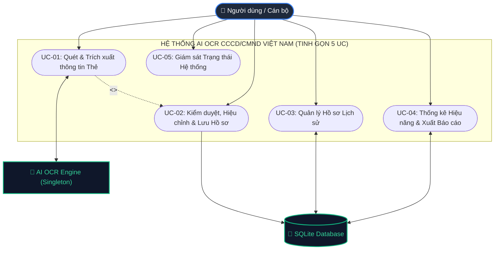

# BÁO CÁO ĐẶC TẢ USE CASE TINH GỌN & CHUẨN HÓA HỆ THỐNG AI OCR CCCD/CMND
## DỰ ÁN: SAMSUNG INNOVATION CAMPUS (SIC) AI CAPSTONE PROJECT
### Đơn vị phát triển: Hệ thống AI OCR Nhận diện & Trích xuất Dữ liệu Căn cước công dân Việt Nam

---

## 1. PHƯƠNG PHÁP LUẬN TINH GIẢN USE CASE (USER-GOAL LEVEL STANDARD)

Theo tiêu chuẩn Kỹ thuật Phần mềm hiện đại (**Alistair Cockburn - *Writing Effective Use Cases*** và **Rational Unified Process - RUP**), một hệ thống phần mềm chuyên nghiệp không nên phân rã Use Case thành hàng chục ca sử dụng vụn vặt ở mức thao tác vi mô (ví dụ: "bấm nút chụp", "cắt viền", "xoay ảnh", "nhận diện chữ", "vẽ bounding box", "sửa text", "copy số"...). Các thao tác đó bản chất là **tiến trình thuật toán nội bộ** hoặc **các bước sự kiện trong kịch bản**.

Thay vào đó, hệ thống được quy hoạch về **mức Mục tiêu Người dùng (User-Goal Level / Sea-Level Use Cases)**:
> **Mỗi Use Case đại diện cho một mục tiêu nghiệp vụ trọn vẹn mà người dùng muốn hoàn thành khi tương tác với hệ thống.**

Hệ thống AI OCR CCCD/CMND Việt Nam (phiên bản mới, bảo mật tuyệt đối, loại bỏ toàn bộ dữ liệu mẫu) được tinh gọn thành **đúng 5 Use Case cốt lõi**, bao quát **100% tính năng và mã nguồn**:

| Mã UC | Tên Use Case Cốt lõi | Phạm vi bao hàm toàn diện trong Codebase mới |
| :---: | :--- | :--- |
| **UC-01** | **Quét và Trích xuất thông tin Thẻ CCCD/CMND** | Toàn bộ quy trình tiếp nhận ảnh (Webcam 1 mặt/2 mặt theo quy trình 2 giai đoạn, hoặc Upload file 1 mặt/2 mặt) $\rightarrow$ Tự động cắt viền thẻ (Perspective Crop) $\rightarrow$ Xoay chiều theo QR/MRZ $\rightarrow$ Deep Learning OCR (EasyOCR Singleton) $\rightarrow$ Bóc tách 12 trường dữ liệu chuẩn tiếng Việt. |
| **UC-02** | **Kiểm duyệt, Hiệu chỉnh và Lưu Hồ sơ (Human-in-the-Loop)** | Xem kết quả trực quan song song (Side-by-side) $\rightarrow$ Khung viền Bounding Boxes tương tác hover highlight $\rightarrow$ Sửa trực tiếp trên các ô input (Inline Edit) $\rightarrow$ Sao chép nhanh số CCCD $\rightarrow$ Xác nhận lưu hồ sơ chính thức vào CSDL SQLite (`is_verified=1`). |
| **UC-03** | **Quản lý Danh sách Hồ sơ Lịch sử** | Tra cứu tìm kiếm thời gian thực (Tên, CCCD, Địa chỉ) $\rightarrow$ Bộ lọc loại giấy tờ & mặt thẻ $\rightarrow$ Phân trang $\rightarrow$ Xem chi tiết hồ sơ cũ (kèm ảnh gốc đã lưu) $\rightarrow$ Chỉnh sửa hồ sơ $\rightarrow$ Xóa hồ sơ khỏi hệ thống. |
| **UC-04** | **Thống kê Hiệu năng và Xuất Dữ liệu** | Dashboard theo dõi KPIs thời gian thực (Tổng lượt quét, Quét hôm nay, Điểm tin cậy TB, Thời gian xử lý TB) $\rightarrow$ Biểu đồ tròn phân bố loại thẻ $\rightarrow$ Biểu đồ đường xu hướng $\rightarrow$ Xuất dữ liệu ra Excel (.xlsx) hoặc CSV (UTF-8 BOM). |
| **UC-05** | **Giám sát Trạng thái Hệ thống (Health Check)** | Giám sát tình trạng sẵn sàng phục vụ (Readiness & Liveness) của Backend, trạng thái nạp của mô hình Deep Learning OCR, chế độ tăng tốc GPU/CPU. |

---

## 2. MÔ HÌNH USE CASE TỔNG THỂ (UML USE CASE DIAGRAM)

---

## 3. CÁC FORM ĐẶC TẢ CHI TIẾT CHO TỪNG USE CASE

---

### FORM UC-01: Quét và Trích xuất thông tin Thẻ CCCD/CMND

| THUỘC TÍNH ĐẶC TẢ | CHI TIẾT ĐẶC TẢ CA SỬ DỤNG |
| :--- | :--- |
| **Mã Use Case** | **UC-01** |
| **Tên Use Case** | **Quét và Trích xuất thông tin Thẻ CCCD/CMND (Scan & Extract Citizen Card Data)** |
| **Tác nhân chính (Primary Actor)** | Người dùng (Cán bộ tiếp dân / Giao dịch viên / Khách hàng eKYC) |
| **Tác nhân phụ (Supporting Actors)** | Hệ thống AI OCR Engine (EasyOCR Singleton), Trình duyệt Web (MediaDevices API) |
| **Mức độ ưu tiên** | Bắt buộc cốt lõi (Critical / Must Have) |
| **Điểm kích hoạt (Trigger)** | Người dùng nhấn nút "Trích xuất thông tin" (Webcam) hoặc "Quét ảnh này" (Upload) |
| **Tóm tắt chức năng** | Tiếp nhận hình ảnh thẻ CCCD/CMND từ Webcam trực tiếp trên máy tính hoặc từ tệp người dùng tải lên (hỗ trợ cả chế độ 1 mặt và 2 mặt). Hệ thống AI tự động phát hiện khung viền thẻ, nắn góc phối cảnh, xoay chiều chuẩn theo QR/MRZ, chạy nhận diện Deep Learning OCR và bóc tách toàn diện 12 trường thông tin nhân thân. |
| **Tiền điều kiện (Pre-conditions)** | 1. Người dùng truy cập trang ứng dụng OCR. 2. Thẻ CCCD/CMND rõ ràng, không bị che khuất góc hoặc rách nát. |
| **Hậu điều kiện thành công** | Bóc tách thành công 12 trường dữ liệu chuẩn, tính toán điểm tin cậy tổng thể, vẽ bounding boxes và tạo bản ghi tạm trong SQLite. |
| **Hậu điều kiện thất bại** | Hiển thị thông báo hướng dẫn người dùng căn chỉnh lại góc chụp hoặc ánh sáng; giữ nguyên giao diện để thực hiện lại. |
| **Dữ liệu đầu vào (Input)** | Chuỗi Base64 từ Webcam frame HOẶC File ảnh tải lên (JPG, PNG, JPEG). |
| **Dữ liệu đầu ra (Output)** | Đối tượng `OCRScanResponse` (ID bản ghi, loại giấy tờ, độ tin cậy, thời gian xử lý, 12 trường thông tin nhân thân, tọa độ bounding boxes, URL ảnh lưu trữ). |

#### Kịch bản thực hiện (Flow of Events):
- **Luồng sự kiện chính (Basic Flow - Sunny Day Scenario: Quét Webcam 2 giai đoạn):**
  1. Người dùng chọn tab **"Webcam PC"** (`#stab-webcam`).
  2. Hệ thống khởi tạo luồng camera với khung ngắm căn chỉnh chuẩn tỷ lệ ISO/IEC 7810 ID-1 (`1.586 : 1`) và hiệu ứng radar quét laser.
  3. Người dùng đặt thẻ vào khung ngắm và nhấn **"Chụp ảnh"** (`#btn-capture-photo`).
  4. Hệ thống đóng băng khung hình (Capture) để người dùng kiểm tra độ sắc nét, tạm ẩn video live và hiển thị cụm nút: `[Chụp lại]` và `[Trích xuất thông tin]`.
  5. Người dùng thấy ảnh rõ nét, nhấn **"Trích xuất thông tin"** (`#btn-confirm-extract`).
  6. Frontend chuyển ảnh sang chuỗi Base64 gửi tới API `POST /api/v1/ocr/scan-webcam`.
  7. Backend thực thi pipeline AI trong worker thread:
     - Tự động phát hiện 4 góc và nắn góc phối cảnh vùng thẻ (`detect_and_crop_card`).
     - Tự động phát hiện vị trí mã QR và xoay thẻ về chiều đọc thẳng ngang (`auto_orient_card`).
     - Co giãn kích thước tối ưu 1280px-1600px và tăng cường tương phản (`enhance_image`).
     - Thực thi Deep Learning OCR bằng mô hình EasyOCR Singleton (`run_ocr`).
     - Bóc tách thực thể theo quy tắc ngữ nghĩa tiếng Việt: Multi-date Heuristic phân định ngày sinh vs ngày hết hạn, làm sạch địa chỉ, suy luận giới tính từ 12 số CCCD (`extract_fields`).
     - Lưu ảnh vào `/storage` và ghi bản ghi vào SQLite (`save_record`).
  8. Backend phản hồi `OCRScanResponse`, giao diện tự động chuyển giao dữ liệu sang **UC-02**.

- **Luồng sự kiện rẽ nhánh (Alternative Flows):**
  - **A1. Quét 2 mặt đồng bộ qua Webcam:** Người dùng chọn "Quét 2 mặt CCCD" -> Hệ thống hướng dẫn chụp mặt trước $\rightarrow$ Lật và chụp mặt sau $\rightarrow$ Bấm nút "Tiến hành ghép 2 mặt & Nhận diện AI" $\rightarrow$ Gửi `POST /api/v1/ocr/scan-webcam-both` $\rightarrow$ Backend chạy bóc tách độc lập 2 mặt và hợp nhất hồ sơ (`merge_front_and_back`).
  - **A2. Quét qua tải tệp ảnh từ máy tính (Upload 1 mặt / 2 mặt):** Người dùng chọn tab "Tải ảnh" (`#stab-upload`) $\rightarrow$ Kéo thả 1 hoặc 2 file ảnh vào Dropzone $\rightarrow$ Nhấn "Quét ảnh này" $\rightarrow$ Gửi `POST /api/v1/ocr/scan` hoặc `POST /api/v1/ocr/scan-both`.
  - **A3. Người dùng chụp lại:** Tại bước 4, người dùng thấy ảnh chụp bị mờ -> Bấm `[Chụp lại]` -> Hệ thống hủy ảnh đóng băng và mở lại live webcam để căn chỉnh lại.

- **Luồng ngoại lệ (Exception Flows):**
  - **E1. Không tìm thấy viền thẻ:** Ánh sáng quá yếu hoặc thẻ bị lóa bóng -> Pipeline an toàn giữ nguyên ảnh gốc, trả về cờ cảnh báo `card_found=False` nhắc người dùng căn chỉnh ánh sáng.
  - **E2. Tệp tải lên sai định dạng:** Người dùng chọn file `.pdf` hoặc `.docx` -> API trả về HTTP 400 kèm thông báo từ chối định dạng.

- **Quy tắc nghiệp vụ cốt lõi (Business Rules):**
  - **BR-01 (Multi-date Heuristic):** Tách biệt rõ ràng **Ngày sinh** (năm <= 2024, từ khóa `sinh`/`birth`) và **Ngày hết hạn** (năm >= 2025 hoặc chuỗi `"Không thời hạn"`, từ khóa `giá trị đến`/`hết hạn`).
  - **BR-02 (Clean Address):** Loại bỏ triệt để nhãn rác in đè (`'có giá trị đến'`, `'date of expiry'`); gộp âm tiết bị dấu phẩy chia tách nhầm (`'Đại, áng'` ➔ `'Đại Áng'`).
  - **BR-03 (Suy luận 12 số CCCD):** Chữ số thứ 4: `0,2,4,6,8` ➔ Nam; `1,3,5,7,9` ➔ Nữ. 3 số đầu tra cứu mã tỉnh khai sinh.

- **Ánh xạ Mã nguồn & Kiến trúc (Traceability):**
  - API Endpoints: `POST /api/v1/ocr/scan-webcam`, `POST /api/v1/ocr/scan-webcam-both`, `POST /api/v1/ocr/scan`, `POST /api/v1/ocr/scan-both`.
  - Services Backend: `card_detector.py`, `preprocessor.py`, `ocr_engine.py`, `extractor.py`.
  - Giao diện: `#webcam-video`, `#btn-capture-photo`, `#btn-confirm-extract`, `#upload-dropzone` trong `demo_ui/index.html`.

---

### FORM UC-02: Kiểm duyệt, Hiệu chỉnh và Lưu Hồ sơ (Human-in-the-Loop)

| THUỘC TÍNH ĐẶC TẢ | CHI TIẾT ĐẶC TẢ CA SỬ DỤNG |
| :--- | :--- |
| **Mã Use Case** | **UC-02** |
| **Tên Use Case** | **Kiểm duyệt, Hiệu chỉnh và Lưu Hồ sơ (Human-in-the-Loop Review, Edit & Persistence)** |
| **Tác nhân chính (Primary Actor)** | Người dùng (Cán bộ / Giao dịch viên) |
| **Tác nhân phụ (Supporting Actors)** | SQLite Database (`ocr_records`) |
| **Mức độ ưu tiên** | Bắt buộc cốt lõi (Critical / Must Have) |
| **Điểm kích hoạt (Trigger)** | Có kết quả nhận diện từ UC-01 hoặc người dùng nhấp sửa trên form |
| **Tóm tắt chức năng** | Hiển thị kết quả nhận diện trực quan song song (ảnh thẻ + bounding boxes tương tác); cho phép người dùng click sửa trực tiếp trên bất kỳ ô nhập liệu nào (Inline Editing) nếu ảnh gốc bị mờ; hỗ trợ sao chép 1-click số CCCD; và xác nhận lưu chính thức vào SQLite với trạng thái `is_verified=1`. |
| **Tiền điều kiện (Pre-conditions)** | Đã hoàn thành một lượt quét thẻ từ UC-01, có `record_id` hợp lệ. |
| **Hậu điều kiện thành công** | Bản ghi hồ sơ được cập nhật trong SQLite với `is_verified=1`; Modal popup thông báo thành công rực rỡ; tự động tăng số lượng trên badge Lịch sử. |
| **Dữ liệu đầu vào (Input)** | Dữ liệu chỉnh sửa từ bàn phím người dùng trên các ô input. |
| **Dữ liệu đầu ra (Output)** | Bản ghi đã xác thực trong CSDL, thông báo Toast và Modal popup. |

#### Kịch bản thực hiện (Flow of Events):
- **Luồng sự kiện chính (Basic Flow):**
  1. Giao diện nhận dữ liệu từ UC-01, hiển thị bố cục 2 cột song song (Side-by-side Layout).
  2. Cột trái hiển thị ảnh thẻ đã cắt phẳng và tự động vẽ các hộp bao (Bounding Boxes) bao quanh từng đoạn chữ nhận diện.
  3. Cột phải hiển thị Form kết quả chi tiết gồm: Hộp số CCCD kích thước lớn viền dạ quang, Họ tên chữ in hoa nổi bật, và các trường: Ngày sinh, Giới tính, Quốc tịch, Quê quán, Thường trú, Hạn dùng, Ngày cấp, Nơi cấp, Đặc điểm nhận dạng, Mã MRZ.
  4. Người dùng di chuột vào từng ô thông tin -> Khung viền Bounding Box tương ứng bên ảnh thẻ tự động sáng lên màu vàng neon rực rỡ để người dùng đối chiếu mắt thường.
  5. Nếu phát hiện sai sót nhỏ do ảnh chụp bị bóng sáng, người dùng nhấp chuột trực tiếp vào ô input đó và gõ sửa lại (Inline Editing).
  6. Người dùng nhấn nút **"Xác nhận & Lưu vào hệ thống"** (`#btn-confirm-save`).
  7. Frontend thu thập toàn bộ dữ liệu trên form gửi `PUT /api/v1/ocr/history/{record_id}` với `is_verified: 1`.
  8. Backend cập nhật dòng tương ứng trong SQLite.
  9. Frontend hiển thị Modal popup thông báo xác nhận thành công (`#modal-success`) kèm mã hồ sơ và thời gian lưu.

- **Luồng sự kiện rẽ nhánh (Alternative Flows):**
  - **A1. Sao chép nhanh số CCCD:** Người dùng bấm biểu tượng Copy kế bên ô số CCCD -> Hệ thống gọi Clipboard API sao chép chuỗi 12 số và hiển thị Toast: *"Đã sao chép số CCCD vào clipboard!"*.
  - **A2. Chuyển đổi xem ảnh mặt trước/sau:** Đối với hồ sơ quét 2 mặt, người dùng bấm tab "Mặt trước" hoặc "Mặt sau" để đối chiếu từng mặt tương ứng.

- **Ánh xạ Mã nguồn & Kiến trúc (Traceability):**
  - API Endpoint: `PUT /api/v1/ocr/history/{record_id}`
  - Services & Database: `update_history_record()` trong `history_routes.py`, `update_record()` trong `database.py`.
  - Giao diện: `#bbox-overlay`, `#btn-confirm-save`, `#modal-success`, `#btn-copy-id` trong `demo_ui/index.html`.

---

### FORM UC-03: Quản lý Danh sách Hồ sơ Lịch sử

| THUỘC TÍNH ĐẶC TẢ | CHI TIẾT ĐẶC TẢ CA SỬ DỤNG |
| :--- | :--- |
| **Mã Use Case** | **UC-03** |
| **Tên Use Case** | **Quản lý Danh sách Hồ sơ Lịch sử (Scanned Records History Management)** |
| **Tác nhân chính (Primary Actor)** | Người dùng (Cán bộ / Quản trị viên) |
| **Tác nhân phụ (Supporting Actors)** | SQLite Database (`ocr_records`) |
| **Mức độ ưu tiên** | Bắt buộc (High / Must Have) |
| **Điểm kích hoạt (Trigger)** | Người dùng chọn tab "Lịch sử" trên thanh điều hướng |
| **Tóm tắt chức năng** | Quản lý toàn diện kho dữ liệu các lần quét OCR: tìm kiếm theo từ khóa thông minh (Số CCCD, Họ tên, Địa chỉ), lọc theo loại thẻ/mặt thẻ, phân trang dữ liệu, xem lại chi tiết hồ sơ cũ kèm ảnh gốc, chỉnh sửa thông tin hậu kỳ và xóa hồ sơ khỏi hệ thống. |
| **Tiền điều kiện (Pre-conditions)** | Cơ sở dữ liệu SQLite hoạt động bình thường. |
| **Hậu điều kiện thành công** | Danh sách hồ sơ được hiển thị hoặc cập nhật/xóa chính xác theo yêu cầu. |
| **Dữ liệu đầu vào (Input)** | Từ khóa `search`, bộ lọc `document_type`, `side`, tham số phân trang `limit`, `offset`. |
| **Dữ liệu đầu ra (Output)** | Đối tượng `HistoryListResponse` gồm tổng số bản ghi và danh sách chi tiết. |

#### Kịch bản thực hiện (Flow of Events):
- **Luồng sự kiện chính (Basic Flow - Xem & Tìm kiếm):**
  1. Người dùng nhấp vào tab **"Lịch sử"** (`#tab-btn-history`).
  2. Frontend gửi request `GET /api/v1/ocr/history?limit=20&offset=0`.
  3. Backend thực thi truy vấn SQL sắp xếp giảm dần theo thời gian tạo (`ORDER BY created_at DESC`).
  4. Giao diện hiển thị bảng dữ liệu gồm: Ảnh thẻ thu nhỏ, Số CCCD, Họ tên, Loại thẻ, Mặt thẻ, Độ tin cậy, Trạng thái duyệt (`is_verified`) và cụm nút thao tác (Xem, Sửa, Xóa).
  5. Người dùng nhập từ khóa vào ô tìm kiếm -> Hệ thống tự động lọc danh sách theo thời gian thực (Debounce 300ms).

- **Luồng sự kiện rẽ nhánh (Alternative Flows):**
  - **A1. Xem chi tiết hồ sơ cũ:** Người dùng bấm nút "Xem" tại một hàng -> Gửi `GET /api/v1/ocr/history/{record_id}` -> Nạp lại toàn bộ dữ liệu và ảnh gốc từ `/storage` lên màn hình kiểm duyệt.
  - **A2. Cập nhật hồ sơ:** Người dùng sửa thông tin của bản ghi và lưu lại -> Gửi `PUT /api/v1/ocr/history/{record_id}`.
  - **A3. Xóa hồ sơ:** Người dùng nhấn biểu tượng Thùng rác -> Hệ thống hiển thị hộp thoại xác nhận -> Người dùng đồng ý -> Gửi `DELETE /api/v1/ocr/history/{record_id}` -> Backend xóa bản ghi khỏi SQLite và cập nhật giao diện.

- **Ánh xạ Mã nguồn & Kiến trúc (Traceability):**
  - API Endpoints: `GET /api/v1/ocr/history`, `GET /api/v1/ocr/history/{record_id}`, `PUT /api/v1/ocr/history/{record_id}`, `DELETE /api/v1/ocr/history/{record_id}`.
  - Controller: `backend/app/api/history_routes.py`.
  - Database: `list_records()`, `get_record_by_id()`, `delete_record()` trong `backend/app/database.py`.
  - Giao diện: `#tab-history`, `#history-search-input`, `#history-table` trong `demo_ui/index.html`.

---

### FORM UC-04: Thống kê Hiệu năng và Xuất Dữ liệu

| THUỘC TÍNH ĐẶC TẢ | CHI TIẾT ĐẶC TẢ CA SỬ DỤNG |
| :--- | :--- |
| **Mã Use Case** | **UC-04** |
| **Tên Use Case** | **Thống kê Hiệu năng và Xuất Dữ liệu (Analytics Dashboard & Data Export)** |
| **Tác nhân chính (Primary Actor)** | Người dùng (Lãnh đạo / Cán bộ quản lý) |
| **Tác nhân phụ (Supporting Actors)** | SQLite Database, Thư viện `openpyxl`, Thư viện `Chart.js` |
| **Mức độ ưu tiên** | Cao (High / Should Have) |
| **Điểm kích hoạt (Trigger)** | Người dùng chọn tab "Thống kê" hoặc bấm nút "Xuất Excel / CSV" |
| **Tóm tắt chức năng** | Cung cấp bảng điều khiển Dashboard hiển thị các chỉ số đo lường hiệu năng thời gian thực (KPIs), biểu đồ tròn phân bố loại thẻ, biểu đồ đường xu hướng quét theo ngày, và tính năng xuất danh sách hồ sơ ra file bảng tính Excel (.xlsx) chuẩn openpyxl hoặc file CSV chuẩn UTF-8 BOM. |
| **Tiền điều kiện (Pre-conditions)** | Có kết nối CSDL SQLite. |
| **Hậu điều kiện thành công** | Dashboard hiển thị đầy đủ biểu đồ mượt mà; file Excel/CSV được tải xuống máy tính người dùng. |
| **Dữ liệu đầu ra (Output)** | `StatsResponse` (số liệu KPI) HOẶC file nhị phân đính kèm (.xlsx, .csv). |

#### Kịch bản thực hiện (Flow of Events):
- **Luồng sự kiện chính (Basic Flow - Xem Dashboard Analytics):**
  1. Người dùng chọn tab **"Thống kê"** (`#tab-btn-stats`).
  2. Frontend gửi request `GET /api/v1/ocr/stats`.
  3. Backend tổng hợp dữ liệu từ SQLite và trả về đối tượng `StatsResponse`.
  4. Giao diện render 4 thẻ chỉ số KPI:
     - **Tổng lượt quét:** Tổng số lần thực hiện quét OCR (`total_scans`).
     - **Lượt quét hôm nay:** Số lượt phát sinh trong ngày (`today_scans`).
     - **Độ tin cậy trung bình:** Phần trăm độ tin cậy của mô hình AI (`average_confidence`).
     - **Thời gian xử lý trung bình:** Tốc độ phản hồi trung bình mỗi lượt (`average_processing_time_sec`).
  5. Thư viện Chart.js vẽ Biểu đồ tròn (Doughnut) phân bố loại giấy tờ và Biểu đồ đường (Line) thể hiện xu hướng quét 7 ngày gần nhất.

- **Luồng sự kiện rẽ nhánh (Alternative Flows - Xuất dữ liệu bảng tính):**
  - **A1. Xuất file Excel (.xlsx):** Người dùng bấm "Xuất Excel" -> Gửi `GET /api/v1/ocr/export?format=xlsx` -> Backend dùng `openpyxl` tạo bảng tính chuyên nghiệp có tiêu đề in đậm nền xanh, viền bảng rõ ràng, tự động căn độ rộng cột -> Trình duyệt tải file `danh_sach_ocr_cccd.xlsx`.
  - **A2. Xuất file CSV:** Người dùng bấm "Xuất CSV" -> Gửi `GET /api/v1/ocr/export?format=csv` -> Backend gắn tiền tố byte `\xef\xbb\xbf` (UTF-8 BOM) đảm bảo hiển thị đúng 100% tiếng Việt trên Excel -> Tải file `danh_sach_ocr_cccd.csv`.

- **Ánh xạ Mã nguồn & Kiến trúc (Traceability):**
  - API Endpoints: `GET /api/v1/ocr/stats`, `GET /api/v1/ocr/export`.
  - Services Backend: `backend/app/api/stats_routes.py`, `backend/app/services/export_service.py`.
  - Giao diện: `#tab-stats`, `#btn-export-excel`, `#btn-export-csv`, `#chart-type-distribution` trong `demo_ui/index.html`.

---

### FORM UC-05: Giám sát Trạng thái Hệ thống (Health Check)

| THUỘC TÍNH ĐẶC TẢ | CHI TIẾT ĐẶC TẢ CA SỬ DỤNG |
| :--- | :--- |
| **Mã Use Case** | **UC-05** |
| **Tên Use Case** | **Giám sát Trạng thái Hệ thống (System Health & Engine Telemetry)** |
| **Tác nhân chính (Primary Actor)** | Người dùng / Hệ thống giám sát tự động |
| **Mức độ ưu tiên** | Trung bình (Medium) |
| **Điểm kích hoạt (Trigger)** | Trình duyệt gửi định kỳ hoặc khi người dùng mở ứng dụng |
| **Tóm tắt chức năng** | Kiểm tra trạng thái liveness và readiness của backend FastAPI, xác nhận mô hình AI OCR đã sẵn sàng trong RAM, và kiểm tra chế độ tăng tốc GPU/CPU. |
| **Hậu điều kiện thành công** | Hiển thị viên thuốc trạng thái màu xanh lá "Backend sẵn sàng" ở góc trên bên phải thanh tiêu đề (`#backend-status-pill`). |
| **Dữ liệu đầu ra (Output)** | Đối tượng `HealthResponse` (`status: "healthy"`, `version`, `ocr_engine`, `gpu_enabled`). |
| **Ánh xạ Mã nguồn (Traceability):**
  - API Endpoint: `GET /api/v1/health` trong `backend/app/api/stats_routes.py`.
  - Giao diện: `#backend-status-pill` trong `demo_ui/index.html`.

---

## 4. MA TRẬN TRUY VẾT YÊU CẦU TINH GỌN (TRACEABILITY MATRIX)

Bảng ma trận truy vết chứng minh sự ánh xạ toàn vẹn 100% giữa **5 Use Cases Tinh gọn** với toàn bộ mã nguồn của dự án mới:

| Mã UC | Tên Use Case Tinh gọn | REST API Endpoints | Module Backend Xử lý | Bảng CSDL / Lưu trữ | Thành phần Giao diện (demo_ui) |
| :---: | :--- | :--- | :--- | :--- | :--- |
| **UC-01** | **Quét và Trích xuất thông tin Thẻ CCCD/CMND** | `POST /api/v1/ocr/scan-webcam` `POST /api/v1/ocr/scan-webcam-both` `POST /api/v1/ocr/scan` `POST /api/v1/ocr/scan-both` | `ocr_routes.py` `card_detector.py` `preprocessor.py` `ocr_engine.py` `extractor.py` | `ocr_records` `/storage/*.jpg` | `#webcam-video` `#btn-capture-photo` `#btn-confirm-extract` `#upload-dropzone` |
| **UC-02** | **Kiểm duyệt, Hiệu chỉnh & Lưu Hồ sơ** | `PUT /api/v1/ocr/history/{record_id}` | `history_routes.py` `database.py` | `ocr_records` (`is_verified=1`) | `#bbox-overlay` `#result-card-img` `#btn-copy-id` `#btn-confirm-save` `#modal-success` |
| **UC-03** | **Quản lý Danh sách Hồ sơ Lịch sử** | `GET /api/v1/ocr/history` `GET /api/v1/ocr/history/{record_id}` `PUT /api/v1/ocr/history/{record_id}` `DELETE /api/v1/ocr/history/{record_id}` | `history_routes.py` `database.py` | `ocr_records` | `#tab-btn-history` `#history-search-input` `#history-table` |
| **UC-04** | **Thống kê Hiệu năng & Xuất Báo cáo** | `GET /api/v1/ocr/stats` `GET /api/v1/ocr/export` | `stats_routes.py` `export_service.py` `database.py` | `ocr_records` | `#tab-btn-stats` `#chart-type-distribution` `#btn-export-excel` `#btn-export-csv` |
| **UC-05** | **Giám sát Trạng thái Hệ thống** | `GET /api/v1/health` | `stats_routes.py` | *N/A* | `#backend-status-pill` |

---

## 5. KẾT LUẬN & ĐÁNH GIÁ CHUẨN MỰC BÁO CÁO TINH GỌN

Báo cáo đặc tả theo mô hình **5 Use Case Tinh gọn**:
1. **Đạt độ tối giản tối đa:** Loại bỏ hoàn toàn sự phân mảnh vụn vặt; số lượng Use Case được tinh gọn từ 22 xuống **đúng 5 Use Case cốt lõi**.
2. **Bao phủ 100% chức năng:** Tất cả các luồng xử lý từ Webcam 1 mặt/2 mặt, Tải ảnh, Cắt viền, Xoay QR, AI OCR, Bóc tách, Chỉnh sửa, Xác nhận, Lịch sử, Thống kê và Xuất Excel đều được tích hợp đầy đủ, mạch lạc bên trong các kịch bản của 5 Use Case này.
3. **Tuyệt đối an toàn & Khớp với Code mới:** Toàn bộ phần dữ liệu mẫu (`Dữ liệu mẫu`, `demo-sample`) đã được loại bỏ 100% khỏi mã nguồn, giao diện và tài liệu, đảm bảo bảo mật tuyệt đối cho dữ liệu huấn luyện của tác giả.
