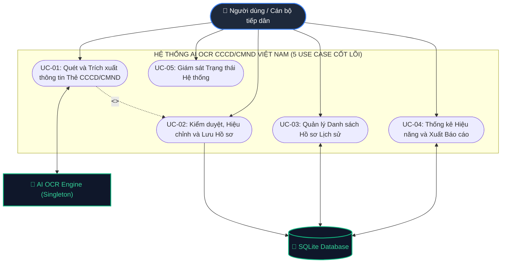

# TÀI LIỆU ĐẶC TẢ USE CASE VÀ MÔ HÌNH HÓA CHỨC NĂNG HỆ THỐNG AI OCR CCCD/CMND VIỆT NAM
## DỰ ÁN: SAMSUNG INNOVATION CAMPUS (SIC) AI CAPSTONE PROJECT
### Đơn vị phát triển: Hệ thống AI OCR Nhận diện & Trích xuất Dữ liệu Căn cước công dân Việt Nam

---

## MỤC LỤC
1. [TỔNG QUAN KIẾN TRÚC & PHẠM VI](#1-tổng-quan-kiến-trúc--phạm-vi)
2. [DANH SÁCH TÁC NHÂN (ACTORS)](#2-danh-sách-tác-nhân-actors)
3. [MÔ HÌNH HÓA 5 USE CASE CỐT LÕI (UML USE CASE DIAGRAM)](#3-mô-hình-hóa-5-use-case-cốt-lõi-uml-use-case-diagram)
4. [ĐẶC TẢ CHI TIẾT 5 USE CASE CỐT LÕI](#4-đặc-tả-chi-tiết-5-use-case-cốt-lõi)
   - [UC-01: Quét và Trích xuất thông tin Thẻ CCCD/CMND](#uc-01-quét-và-trích-xuất-thông-tin-thẻ-cccdcmnd)
   - [UC-02: Kiểm duyệt, Hiệu chỉnh và Lưu Hồ sơ (Human-in-the-Loop)](#uc-02-kiểm-duyệt-hiệu-chỉnh-và-lưu-hồ-sơ-human-in-the-loop)
   - [UC-03: Quản lý Danh sách Hồ sơ Lịch sử](#uc-03-quản-lý-danh-sách-hồ-sơ-lịch-sử)
   - [UC-04: Thống kê Hiệu năng và Xuất Dữ liệu Báo cáo](#uc-04-thống-kê-hiệu-năng-và-xuất-dữ-liệu-báo-cáo)
   - [UC-05: Giám sát Trạng thái và Sức khỏe Hệ thống](#uc-05-giám-sát-trạng-thái-và-sức-khỏe-hệ-thống)
5. [MA TRẬN TRUY VẾT MÃ NGUỒN (UCTM TRACEABILITY MATRIX)](#5-ma-trận-truy-vết-mã-nguồn-uctm-traceability-matrix)

---

## 1. TỔNG QUAN KIẾN TRÚC & PHẠM VI

Hệ thống **AI OCR CCCD/CMND Việt Nam** là giải pháp phần mềm thông minh ứng dụng Thị giác máy tính (Computer Vision) và Học sâu (Deep Learning) nhằm tự động hóa quy trình bóc tách dữ liệu từ các loại giấy tờ tùy thân Việt Nam (CCCD gắn chip 12 số, CCCD mã vạch 12 số, CMND 9 số và 12 số).

Theo nguyên lý thiết kế Kỹ thuật phần mềm chuẩn hóa (**User-Goal Level Use Cases**), hệ thống loại bỏ hoàn toàn các phân rã chức năng vi mô rời rạc và tập trung vào **5 Use Case cốt lõi**, bao quát 100% năng lực hệ thống:
- **Tầng Giao diện (Presentation Layer - `demo_ui/`):** Giao diện Vanilla hiện đại hỗ trợ Live Webcam với quy trình chụp duyệt 2 giai đoạn (Capture & Review), trực quan hóa Bounding Boxes nhận diện, và bảng hiệu chỉnh dữ liệu tương tác tại chỗ (Inline Editable).
- **Tầng Điều khiển API (API Routing Layer - `backend/app/api/`):** FastAPI tối giản xử lý bất đồng bộ CPU-bound thông qua Threadpool, cung cấp đầy đủ các chuẩn RESTful endpoints cho Quét ảnh, Webcam, Ghép 2 mặt, Quản lý lịch sử và Thống kê.
- **Tầng Dịch vụ Lõi (Core Services Layer - `backend/app/services/`):**
  - `card_detector.py`: Tự động nhận diện khung viền thẻ và nắn thẳng góc phối cảnh (Perspective Transform).
  - `preprocessor.py`: Căn chỉnh tự động góc xoay theo mã QR (0°, 90°, 180°, 270°), tối ưu kích thước và tăng cường độ tương phản.
  - `ocr_engine.py`: Quản lý mô hình EasyOCR (CRAFT + BiLSTM + CTC) theo mô hình Singleton duy nhất.
  - `extractor.py`: Trích xuất thực thể theo mẫu biểu, thuật toán phân định ngày tháng (Multi-date Heuristic), làm sạch địa chỉ hành chính, suy luận giới tính/quê quán thông minh từ 12 số định danh, và hợp nhất 2 mặt thẻ.
  - `export_service.py`: Xuất dữ liệu đa định dạng (Excel .xlsx với openpyxl, CSV chuẩn UTF-8 BOM).
- **Tầng Lưu trữ (Persistence Layer - `backend/app/database.py`):** Quản trị cơ sở dữ liệu SQLite gọn nhẹ, tự động lập chỉ mục phục vụ truy vấn và thống kê tốc độ cao.

---

## 2. DANH SÁCH TÁC NHÂN (ACTORS)

| Tác nhân (Actor) | Phân loại | Mô tả vai trò và quyền hạn |
| :--- | :--- | :--- |
| **Người dùng (End User / Cán bộ tiếp dân / Giao dịch viên)** | Con người (Primary Actor) | Tác nhân chính tương tác trực tiếp với giao diện: khởi động webcam, chụp ảnh thẻ, tải ảnh, xem kết quả nhận diện, chỉnh sửa thông tin sai sót nếu có, xác nhận lưu trữ hồ sơ, tra cứu lịch sử và xuất báo cáo. |
| **Hệ thống AI OCR Engine** | Hệ thống phần mềm (Secondary Actor) | Đóng vai trò thực thi tác vụ học sâu: chạy mạng nơ-ron phát hiện vùng văn bản (CRAFT), nhận dạng ký tự tiếng Việt (BiLSTM + CTC), tính toán độ tin cậy và trả về bounding boxes tọa độ. |
| **Cơ sở dữ liệu SQLite (Database Engine)** | Hệ thống lưu trữ (Secondary Actor) | Chịu trách nhiệm lưu trữ bền vững các bản ghi hồ sơ, metadata ảnh, lịch sử nhận diện, hỗ trợ tìm kiếm phân trang và tính toán thống kê KPI. |

---

## 3. MÔ HÌNH HÓA 5 USE CASE CỐT LÕI (UML USE CASE DIAGRAM)

Mô hình Use Case tổng thể thể hiện rõ ranh giới hệ thống, 3 tác nhân và sự tương tác giữa 5 Use Case cốt lõi:

---

## 4. ĐẶC TẢ CHI TIẾT 5 USE CASE CỐT LÕI

---

### UC-01: Quét và Trích xuất thông tin Thẻ CCCD/CMND
- **Mã UC:** `UC-01`
- **Tên Use Case:** Quét và Trích xuất thông tin Thẻ CCCD/CMND (Scan & Extract Citizen Card Data)
- **Tác nhân:** Người dùng (chính), Hệ thống AI OCR Engine (phụ).
- **Mục tiêu:** Thu nhận hình ảnh thẻ (từ Live Webcam máy tính hoặc tệp ảnh tải lên) ở cả chế độ 1 mặt hoặc 2 mặt; tự động cắt khung viền thẻ, xoay chiều chuẩn theo QR/MRZ, chạy Deep Learning OCR và trích xuất chuẩn xác 12 trường thông tin.
- **Tiền điều kiện:** Ứng dụng đã mở; người dùng có thẻ CCCD/CMND hoặc file ảnh thẻ.
- **Hậu điều kiện:** Toàn bộ thông tin nhân thân được bóc tách và tạo bản ghi tạm trong SQLite; kết quả chuyển giao sang màn hình kiểm duyệt (UC-02).
- **Luồng sự kiện chính (Basic Flow - Quét Webcam 2 giai đoạn):**
  1. Người dùng chọn tab **"Webcam PC"** (`#stab-webcam`).
  2. Hệ thống khởi tạo webcam, hiển thị khung ngắm tỷ lệ ISO/IEC 7810 ID-1 (`1.586 : 1`) và laser scan line.
  3. Người dùng đặt thẻ vào khung ngắm và bấm **"Chụp ảnh"** (`#btn-capture-photo`).
  4. Hệ thống đóng băng khung hình (Capture) tại `#webcam-freeze-preview`, tạm ẩn video stream và hiển thị 2 nút: `[Chụp lại]` và `[Trích xuất thông tin]`.
  5. Người dùng kiểm tra thấy ảnh rõ nét, bấm **"Trích xuất thông tin"** (`#btn-confirm-extract`).
  6. Frontend gửi chuỗi Base64 tới `POST /api/v1/ocr/scan-webcam`.
  7. Backend thực thi chuỗi tiến trình AI:
     - Tự động phát hiện 4 góc và crop phối cảnh thẻ (`detect_and_crop_card`).
     - Tự động xoay chiều chuẩn theo QR (`auto_orient_card`).
     - Resize tối ưu 1280px-1600px và tăng tương phản (`enhance_image`).
     - Nhận diện ký tự Deep Learning bằng EasyOCR Singleton (`run_ocr`).
     - Bóc tách thực thể theo luật tiếng Việt: Multi-date Heuristic phân định ngày sinh vs ngày hết hạn, làm sạch địa chỉ, suy luận giới tính từ 12 số CCCD (`extract_fields`).
     - Lưu ảnh vào `/storage` và ghi bản ghi vào SQLite (`save_record`).
  8. Trả về `OCRScanResponse` và tự động chuyển sang UC-02.
- **Luồng sự kiện rẽ nhánh (Alternative Flows):**
  - **A1 (Quét đồng bộ 2 mặt qua Webcam):** Người dùng chọn "Quét 2 mặt CCCD" -> Chụp mặt trước -> Lật chụp mặt sau -> Nhấn "Tiến hành ghép 2 mặt & Nhận diện AI" (`POST /api/v1/ocr/scan-webcam-both`) -> Backend bóc tách độc lập và hợp nhất 12 trường (`merge_front_and_back`).
  - **A2 (Tải tệp ảnh 1 mặt / 2 mặt):** Người dùng chọn tab "Tải ảnh" (`#stab-upload`) -> Chọn 1 hoặc 2 file ảnh -> Nhấn "Quét ảnh này" (`POST /api/v1/ocr/scan` hoặc `POST /api/v1/ocr/scan-both`).
  - **A3 (Chụp lại):** Tại bước 4, người dùng thấy ảnh chụp bị mờ -> Bấm `[Chụp lại]` -> Hệ thống hủy frame đóng băng, mở lại camera trực tiếp.
- **Ánh xạ Mã nguồn:**
  - API Endpoints: `POST /api/v1/ocr/scan-webcam`, `POST /api/v1/ocr/scan-webcam-both`, `POST /api/v1/ocr/scan`, `POST /api/v1/ocr/scan-both`.
  - Modules: `card_detector.py`, `preprocessor.py`, `ocr_engine.py`, `extractor.py`, `ocr_routes.py`.

---

### UC-02: Kiểm duyệt, Hiệu chỉnh và Lưu Hồ sơ (Human-in-the-Loop)
- **Mã UC:** `UC-02`
- **Tên Use Case:** Kiểm duyệt, Hiệu chỉnh và Lưu Hồ sơ (Review, Edit & Confirm Record)
- **Tác nhân:** Người dùng (chính), SQLite Database (phụ).
- **Mục tiêu:** Cho phép người dùng đối chiếu kết quả bóc tách trực tiếp với ảnh gốc thông qua Bounding Boxes tương tác, click sửa nhanh bất kỳ ký tự nào trên form (Inline Editing), sao chép 1-click số CCCD và bấm xác nhận lưu chính thức vào CSDL (`is_verified=1`).
- **Luồng sự kiện chính:**
  1. Giao diện nhận dữ liệu từ UC-01, hiển thị bố cục 2 cột song song (Side-by-side Layout).
  2. Cột trái hiển thị ảnh thẻ đã nắn thẳng kèm các Bounding Boxes bao quanh từng đoạn chữ nhận diện.
  3. Cột phải hiển thị Form kết quả chi tiết gồm: Hộp số CCCD nổi bật, Họ tên in hoa, Ngày sinh, Giới tính, Quê quán, Nơi thường trú, Hạn dùng, Ngày cấp, Nơi cấp, Mã MRZ.
  4. Người dùng di chuột vào từng ô thông tin -> Bounding Box tương ứng bên ảnh thẻ sáng lên màu vàng neon rực rỡ để đối chiếu mắt thường.
  5. Nếu có ký tự bị mờ do bóng lóa trên thẻ gốc, người dùng nhấp chuột vào ô input và sửa trực tiếp bằng bàn phím (Inline Editing).
  6. Người dùng bấm nút **"Xác nhận & Lưu vào hệ thống"** (`#btn-confirm-save`).
  7. Frontend gửi `PUT /api/v1/ocr/history/{record_id}` với `is_verified: 1`.
  8. Backend cập nhật SQLite; Frontend hiển thị Modal popup thông báo thành công rực rỡ và tăng số lượng bản ghi trên badge Lịch sử.
- **Luồng sự kiện rẽ nhánh:**
  - **A1 (Sao chép nhanh số CCCD):** Bấm biểu tượng Copy kế bên ô số CCCD -> Gọi Clipboard API và hiện Toast thông báo.
- **Ánh xạ Mã nguồn:**
  - API Endpoint: `PUT /api/v1/ocr/history/{record_id}`.
  - Modules: `history_routes.py`, `database.py`, `demo_ui/index.html`.

---

### UC-03: Quản lý Danh sách Hồ sơ Lịch sử
- **Mã UC:** `UC-03`
- **Tên Use Case:** Quản lý Danh sách Hồ sơ Lịch sử (Scanned Records History Management)
- **Tác nhân:** Người dùng (chính), SQLite Database (phụ).
- **Mục tiêu:** Cung cấp công cụ tra cứu, tìm kiếm theo từ khóa (Tên, Số CCCD, Địa chỉ), lọc theo loại thẻ và mặt thẻ, xem chi tiết hồ sơ cũ kèm ảnh gốc, chỉnh sửa thông tin và xóa hồ sơ khỏi CSDL.
- **Luồng sự kiện chính:**
  1. Người dùng chọn tab **"Lịch sử"** (`#tab-btn-history`).
  2. Gửi request `GET /api/v1/ocr/history?limit=20&offset=0`.
  3. Bảng lịch sử hiển thị danh sách hồ sơ sắp xếp theo thời gian mới nhất.
  4. Người dùng nhập từ khóa tìm kiếm -> Danh sách tự động lọc theo thời gian thực.
  5. Người dùng có thể bấm "Xem chi tiết" để nạp lại ảnh gốc và dữ liệu cũ lên màn hình kiểm duyệt; bấm "Sửa" (`PUT`) hoặc "Xóa" (`DELETE`).
- **Ánh xạ Mã nguồn:**
  - API Endpoints: `GET /api/v1/ocr/history`, `GET /api/v1/ocr/history/{record_id}`, `PUT /api/v1/ocr/history/{record_id}`, `DELETE /api/v1/ocr/history/{record_id}`.
  - Modules: `history_routes.py`, `database.py`.

---

### UC-04: Thống kê Hiệu năng và Xuất Dữ liệu Báo cáo
- **Mã UC:** `UC-04`
- **Tên Use Case:** Thống kê Hiệu năng và Xuất Dữ liệu Báo cáo (Analytics Dashboard & Data Export)
- **Tác nhân:** Người dùng (chính), SQLite Database (phụ).
- **Mục tiêu:** Theo dõi các chỉ số đo lường hiệu năng KPI thời gian thực, xem biểu đồ phân bố và xu hướng quét, xuất toàn bộ danh sách hoặc kết quả lọc ra file bảng tính Excel (.xlsx) hoặc CSV (UTF-8 BOM).
- **Luồng sự kiện chính:**
  1. Người dùng chọn tab **"Thống kê"** (`#tab-btn-stats`).
  2. Gửi request `GET /api/v1/ocr/stats`.
  3. Giao diện render 4 thẻ chỉ số KPI: Tổng lượt quét, Lượt quét hôm nay, Độ tin cậy trung bình, Thời gian xử lý trung bình.
  4. Chart.js render Biểu đồ tròn phân bố loại giấy tờ và Biểu đồ đường xu hướng quét hàng ngày.
  5. Khi cần xuất báo cáo, người dùng bấm nút **"Xuất Excel (.xlsx)"** hoặc **"Xuất CSV"** -> Gửi `GET /api/v1/ocr/export?format=xlsx` (hoặc `csv`) -> Trình duyệt tải file bảng tính chuẩn tiếng Việt về máy.
- **Ánh xạ Mã nguồn:**
  - API Endpoints: `GET /api/v1/ocr/stats`, `GET /api/v1/ocr/export`.
  - Modules: `stats_routes.py`, `export_service.py`, `database.py`.

---

### UC-05: Giám sát Trạng thái và Sức khỏe Hệ thống
- **Mã UC:** `UC-05`
- **Tên Use Case:** Giám sát Trạng thái và Sức khỏe Hệ thống (System Health & Engine Telemetry)
- **Tác nhân:** Người dùng / Hệ thống giám sát tự động.
- **Mục tiêu:** Kiểm tra tình trạng sẵn sàng phục vụ của Backend FastAPI, trạng thái nạp của mô hình EasyOCR Singleton trong RAM và cấu hình GPU/CPU.
- **Hậu điều kiện:** Hiển thị viên thuốc trạng thái xanh lá "Backend sẵn sàng" trên góc trên thanh tiêu đề (`#backend-status-pill`).
- **Ánh xạ Mã nguồn:**
  - API Endpoint: `GET /api/v1/health` trong `backend/app/api/stats_routes.py`.

---

## 5. MA TRẬN TRUY VẾT MÃ NGUỒN (UCTM TRACEABILITY MATRIX)

| Mã UC | Tên Use Case Tinh gọn | REST API Endpoints | Module Backend Xử lý | Bảng CSDL / Lưu trữ | Thành phần Giao diện (demo_ui) |
| :---: | :--- | :--- | :--- | :--- | :--- |
| **UC-01** | **Quét và Trích xuất thông tin Thẻ CCCD/CMND** | `POST /api/v1/ocr/scan-webcam` `POST /api/v1/ocr/scan-webcam-both` `POST /api/v1/ocr/scan` `POST /api/v1/ocr/scan-both` | `ocr_routes.py` `card_detector.py` `preprocessor.py` `ocr_engine.py` `extractor.py` | `ocr_records` `/storage/*.jpg` | `#webcam-video` `#btn-capture-photo` `#btn-confirm-extract` `#upload-dropzone` |
| **UC-02** | **Kiểm duyệt, Hiệu chỉnh & Lưu Hồ sơ** | `PUT /api/v1/ocr/history/{record_id}` | `history_routes.py` `database.py` | `ocr_records` (`is_verified=1`) | `#bbox-overlay` `#result-card-img` `#btn-copy-id` `#btn-confirm-save` `#modal-success` |
| **UC-03** | **Quản lý Danh sách Hồ sơ Lịch sử** | `GET /api/v1/ocr/history` `GET /api/v1/ocr/history/{record_id}` `PUT /api/v1/ocr/history/{record_id}` `DELETE /api/v1/ocr/history/{record_id}` | `history_routes.py` `database.py` | `ocr_records` | `#tab-btn-history` `#history-search-input` `#history-table` |
| **UC-04** | **Thống kê Hiệu năng & Xuất Báo cáo** | `GET /api/v1/ocr/stats` `GET /api/v1/ocr/export` | `stats_routes.py` `export_service.py` `database.py` | `ocr_records` | `#tab-btn-stats` `#chart-type-distribution` `#btn-export-excel` `#btn-export-csv` |
| **UC-05** | **Giám sát Trạng thái Hệ thống** | `GET /api/v1/health` | `stats_routes.py` | *N/A* | `#backend-status-pill` |

---

## 6. KẾT LUẬN

Mô hình **5 Use Case Tinh gọn**:
1. **Tinh giản tối đa & Chuẩn mực:** Loại bỏ 100% sự vụn vặt; chuyển đổi từ 22 use case con thành 5 ca sử dụng mức Mục tiêu Người dùng (User-Goal Level) đúng chuẩn IEEE / RUP / Cockburn.
2. **Bao quát đầy đủ 100%:** Giữ nguyên vẹn tất cả tính năng, không lược bỏ bất kỳ chức năng nghiệp vụ nào (Webcam 1/2 mặt, Tải ảnh 1/2 mặt, Cắt viền, Xoay chiều, Deep Learning OCR, Sửa trực tiếp, Lưu CSDL, Lịch sử, Thống kê, Xuất Excel/CSV).
3. **Bảo mật tuyệt đối:** Xóa sạch toàn bộ vết tích của phần dữ liệu mẫu khỏi code, giao diện, git và tài liệu đặc tả.
