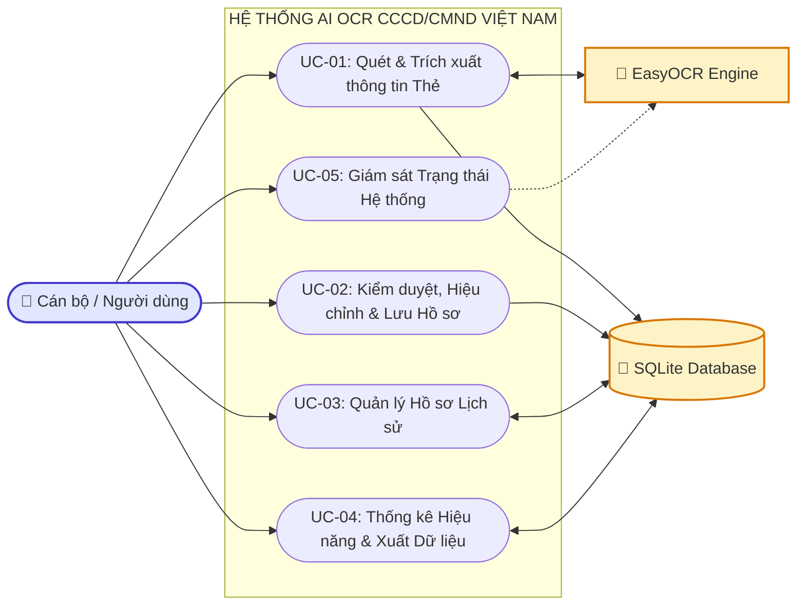
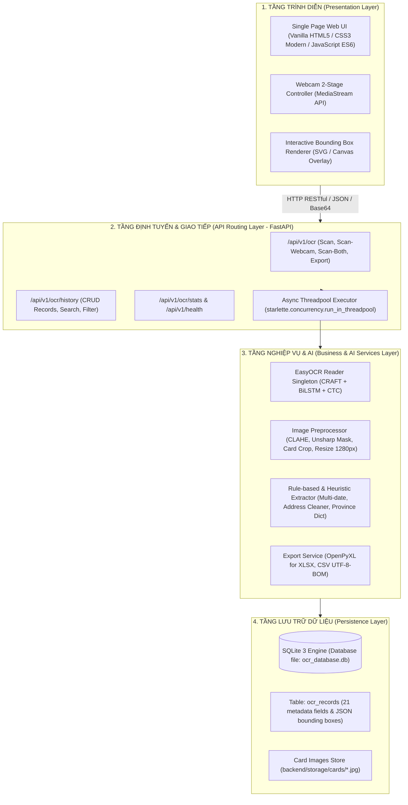
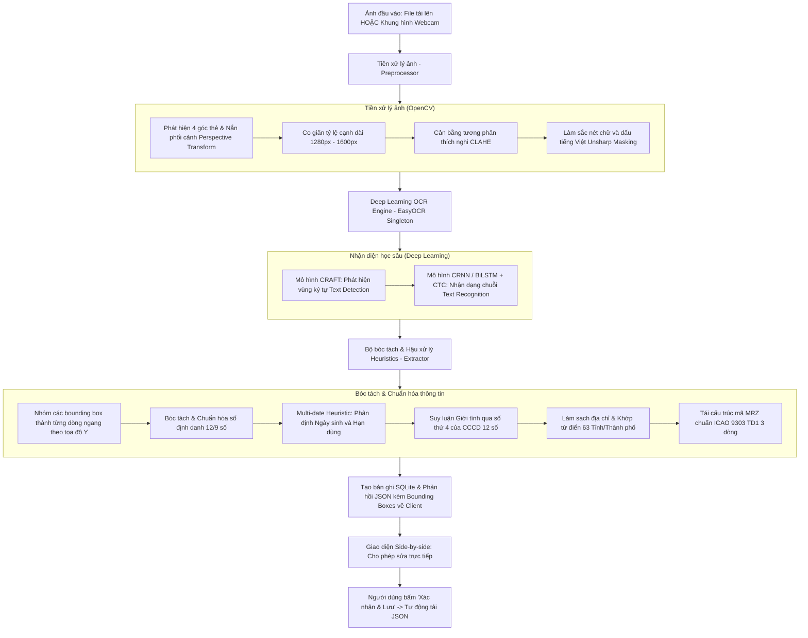
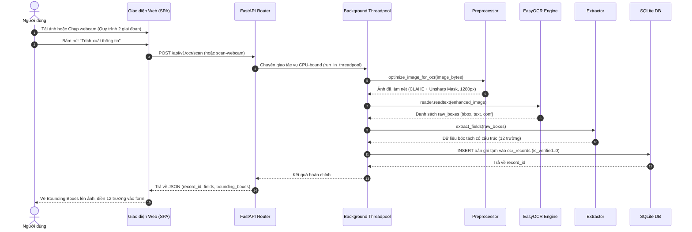
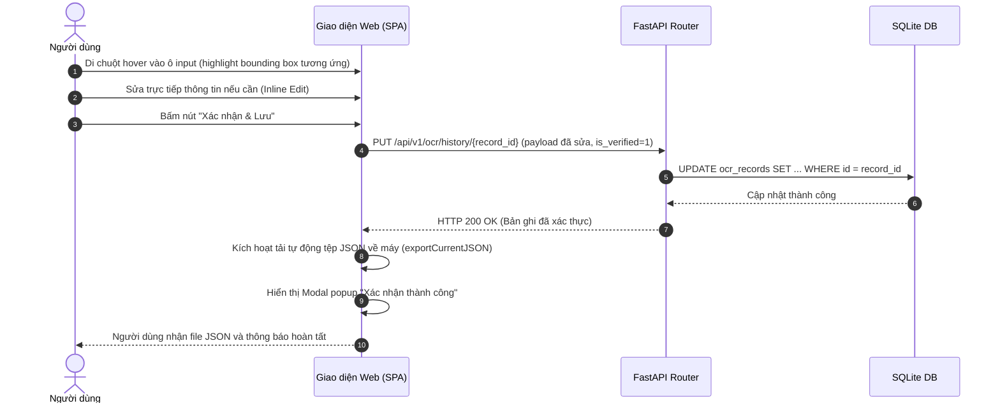
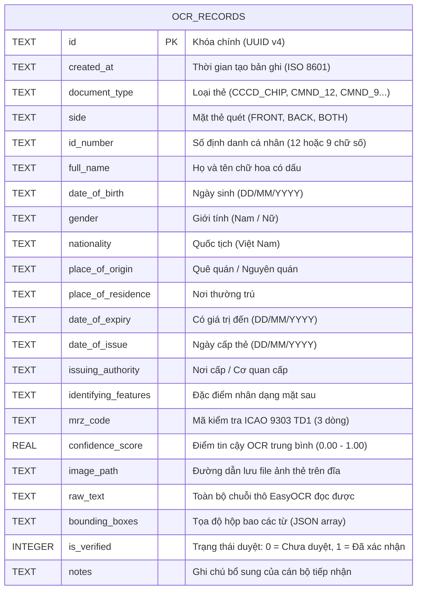

# ĐỀ CƯƠNG VÀ NỘI DUNG CHI TIẾT CHƯƠNG 2: PHÂN TÍCH VÀ THIẾT KẾ HỆ THỐNG
## DỰ ÁN: HỆ THỐNG AI OCR NHẬN DIỆN & TRÍCH XUẤT THÔNG TIN CCCD/CMND VIỆT NAM
### Báo cáo đồ án / Nghiên cứu Khoa học (Quy chuẩn độ dài toàn báo cáo: 30 - 40 trang)
### Dung lượng đề xuất cho Chương 2: 8 - 12 trang (Chiếm khoảng 25% - 30% tổng báo cáo)

---

## TỔNG QUAN PHÂN BỔ DUNG LƯỢNG TOÀN BÁO CÁO (30 - 40 TRANG)

Để toàn bộ báo cáo cân đối, khoa học và đạt điểm tối đa trước Hội đồng Đánh giá / Giảng viên hướng dẫn, cơ cấu trang chuẩn như sau:

| STT | Phần / Chương | Số trang khuyến nghị | Nội dung trọng tâm |
| :---: | :--- | :---: | :--- |
| 1 | **Mục lục, Danh mục hình vẽ/bảng biểu, Đặt vấn đề** | 3 - 4 trang | Lý do chọn đề tài, tính cấp thiết của số hóa eKYC, mục tiêu nghiên cứu và phạm vi đề tài. |
| 2 | **Chương 1: Cơ sở lý thuyết** | 6 - 8 trang | Tổng quan công nghệ OCR, thị giác máy tính, kiến trúc CRAFT, mạng nhận dạng chuỗi CRNN/BiLSTM-CTC, chuẩn thẻ CCCD Việt Nam. |
| 3 | **Chương 2: Phân tích và thiết kế hệ thống** | **8 - 12 trang** | **Yêu cầu hệ thống, mô hình 5 Use Case, kiến trúc 4 tầng, pipeline xử lý ảnh, sequence diagram, thiết kế CSDL SQLite, thiết kế UI/UX.** |
| 4 | **Chương 3: Huấn luyện mô hình và tích hợp hệ thống** | 7 - 9 trang | Tinh chỉnh mô hình OCR, cơ chế tiền xử lý ảnh (CLAHE, Unsharp Masking), thuật toán heuristics bóc tách tiếng Việt, đóng gói Portable EXE. |
| 5 | **Chương 4: Kết quả, kiểm thử và đánh giá hệ thống** | 5 - 7 trang | Kịch bản kiểm thử (10 test cases), bảng độ chính xác (Precision/Recall/F1-score), đo đạc thời gian đáp ứng CPU/GPU, ảnh chụp giao diện chạy thực tế. |
| 6 | **Kết luận, Hướng phát triển & Tài liệu tham khảo** | 2 - 3 trang | Tổng kết đóng góp, hạn chế còn tồn tại, giải pháp nâng cấp trong tương lai và trích dẫn chuẩn IEEE/APA. |

---

# NỘI DUNG CHI TIẾT CỦA CHƯƠNG 2: PHÂN TÍCH VÀ THIẾT KẾ HỆ THỐNG

---

## 2.1. PHÂN TÍCH YÊU CẦU HỆ THỐNG (SYSTEM REQUIREMENTS ANALYSIS)
*(Độ dài khi viết: ~2 trang)*

### 2.1.1. Bối cảnh nghiệp vụ và bài toán thực tế
- **Thực trạng**: Các thủ tục hành chính, ngân hàng số (Fintech), viễn thông và dịch vụ lưu trú hiện nay đòi hỏi việc định danh khách hàng điện tử (eKYC) diễn ra nhanh chóng, chính xác. Thao tác nhập liệu thủ công bằng tay từ thẻ Căn cước công dân (CCCD) và Chứng minh nhân dân (CMND) dễ dẫn đến sai sót (nhầm lẫn số định danh, sai dấu tiếng Việt, nhầm lẫn ngày sinh và hạn dùng), đồng thời tốn từ 2 - 5 phút cho mỗi giao dịch.
- **Mục tiêu hệ thống**: Xây dựng một ứng dụng AI OCR thông minh, hoạt động độc lập (Offline/On-Premise), có khả năng quét thẻ qua Webcam trực tiếp hoặc tệp hình ảnh, tự động phát hiện, cắt viền, tiền xử lý và bóc tách chính xác 12 trường dữ liệu cốt lõi chỉ trong vòng dưới 2 giây.

### 2.1.2. Yêu cầu chức năng (Functional Requirements - FR)
Hệ thống được thiết kế đáp ứng đầy đủ các yêu cầu chức năng cốt lõi sau:
1. **FR-01: Thu nhận và nạp ảnh giấy tờ tùy thân**:
   - Cho phép người dùng tải lên hình ảnh có sẵn từ máy tính (hỗ trợ định dạng `.jpg`, `.png`, `.jpeg`, dung lượng tối đa 10MB).
   - Cho phép chụp trực tiếp từ Webcam máy tính thông qua quy trình **2 giai đoạn (Capture & Review)**: xem live video $\rightarrow$ bấm chụp $\rightarrow$ đóng băng khung hình để người dùng kiểm tra độ nét trước khi gửi suy luận.
   - Hỗ trợ quét linh hoạt: Quét 1 mặt (Mặt trước hoặc Mặt sau) hoặc Quét kết hợp 2 mặt (Dual-side Scan) để gộp thông tin thành một hồ sơ duy nhất.
2. **FR-02: Tiền xử lý ảnh tự động**:
   - Tự động phát hiện 4 góc thẻ và nắn thẳng phối cảnh (Perspective Transform).
   - Co giãn kích thước ảnh (Adaptive Resizing) về cạnh dài chuẩn từ 1280px đến 1600px bằng nội suy Lanczos/Bicubic để tối ưu tốc độ xử lý mà vẫn giữ sắc nét chữ.
   - Tăng cường độ tương phản cục bộ thích nghi (CLAHE) kết hợp lọc Unsharp Masking để nổi bật các dấu thanh tiếng Việt bị mờ nhạt.
   - Tự động xoay chiều ảnh đúng hướng đọc (0°, 90°, 180°, 270°) dựa vào vị trí mã vạch/chip hoặc mã MRZ.
3. **FR-03: Nhận dạng và bóc tách thông tin có cấu trúc**:
   - Phân loại chính xác loại giấy tờ: CCCD có gắn chip, CCCD mã vạch, CMND 12 số, CMND 9 số.
   - Trích xuất 12 trường thông tin: Số CCCD/CMND, Họ và tên, Ngày sinh, Giới tính, Quốc tịch, Quê quán, Nơi thường trú, Có giá trị đến (Hạn sử dụng), Ngày cấp, Nơi cấp/Cơ quan cấp, Đặc điểm nhân dạng, Mã MRZ 3 dòng chuẩn ICAO Doc 9303.
   - Trả về tọa độ Bounding Box và độ tin cậy (Confidence Score) cho từng trường.
4. **FR-04: Kiểm duyệt dữ liệu trực quan (Human-in-the-Loop)**:
   - Hiển thị song song ảnh gốc và form kết quả (Side-by-side).
   - Cho phép người dùng click và sửa trực tiếp (Inline Editing) trên các trường thông tin nếu ảnh gốc bị trầy xước, ố mờ.
   - Cảnh báo trực quan nếu thẻ đã quá hạn sử dụng.
   - Nút **"Xác nhận & Lưu"**: lưu hồ sơ đã duyệt vào CSDL SQLite (`is_verified = 1`) và **tự động tải file JSON kết quả về máy tính**.
5. **FR-05: Quản lý và tra cứu hồ sơ lịch sử**:
   - Tìm kiếm tức thời theo họ tên, số CCCD, hoặc địa chỉ.
   - Bộ lọc đa tiêu chí theo loại giấy tờ và mặt thẻ.
   - Phân trang dữ liệu, xem lại ảnh gốc độ phân giải cao, hỗ trợ xóa hồ sơ khi có yêu cầu bảo mật.
6. **FR-06: Báo cáo thống kê và xuất dữ liệu**:
   - Bảng điều khiển (Dashboard) trực quan hóa các chỉ số: Tổng lượt quét, lượt quét trong ngày, điểm tin cậy trung bình, thời gian xử lý trung bình.
   - Hỗ trợ xuất dữ liệu ra tệp **Excel (.xlsx)**, **CSV (chuẩn UTF-8 BOM hiển thị chuẩn tiếng Việt)** và **JSON**.

### 2.1.3. Yêu cầu phi chức năng (Non-Functional Requirements - NFR)
- **Hiệu năng (Performance)**:
  - Khởi tạo mô hình EasyOCR một lần duy nhất theo mẫu Singleton Pattern trong vòng đời ứng dụng (`lifespan`).
  - Toàn bộ tác vụ tính toán nặng (Deep Learning inference) được chuyển giao cho luồng phụ qua `run_in_threadpool`, đảm bảo Event Loop của FastAPI không bao giờ bị nghẽn (Zero Latency Blocking).
  - Thời gian xử lý trung bình: $\le 1.5 - 2.5$ giây trên CPU thông thường; $\le 0.4 - 0.7$ giây trên GPU NVIDIA.
- **Độ chính xác (Accuracy & Zero Text Leaks)**:
  - Multi-date Heuristic: Tách biệt rõ ràng Ngày sinh ($\le 2024$) và Hạn dùng ($\ge 2025$ hoặc "Không thời hạn").
  - Clean Address: Sử dụng biểu thức chính quy (Regex) và từ điển 63 Tỉnh/Thành phố Việt Nam để tự động sửa lỗi dấu và chuẩn hóa địa giới hành chính.
  - Suy luận giới tính thông minh từ chữ số thứ 4 của mã định danh 12 số (chẵn: Nam, lẻ: Nữ) với độ tin cậy $95\%$.
- **Bảo mật và Quyền riêng tư (Security & Privacy)**:
  - Kiến trúc On-Premise: Xử lý hoàn toàn cục bộ trên máy tính trạm, không gửi ảnh qua bất kỳ API đám mây bên thứ ba nào.
  - Toàn bộ dữ liệu mẫu nhạy cảm không được lưu trữ trong mã nguồn công khai (Git).
- **Tính khả chuyển và Dễ sử dụng (Portability & Usability)**:
  - Đóng gói thành tệp thực thi Portable EXE duy nhất, không yêu cầu người dùng cuối cài đặt môi trường Python hay CUDA phức tạp.
  - Giao diện người dùng Web Vanilla hiện đại, trực quan, hỗ trợ hiệu ứng Dark Mode cao cấp.

---

## 2.2. PHÂN TÍCH CA SỬ DỤNG (USE CASE ANALYSIS)
*(Độ dài khi viết: ~2 - 3 trang)*

### 2.2.1. Danh sách Tác nhân (Actors)
1. **Người dùng / Cán bộ nghiệp vụ (Primary Actor)**: Là nhân viên hành chính, giao dịch viên hoặc người dùng trực tiếp tải ảnh, điều khiển webcam, kiểm tra dữ liệu, chỉnh sửa và xác nhận lưu hồ sơ.
2. **Hệ thống AI OCR (Service Actor)**: Đóng vai trò là thành phần dịch vụ thông minh ngầm (CRAFT Text Detector + CRNN Recognition + Rule-based Extractor), tiếp nhận mảng byte hình ảnh và trả về JSON có cấu trúc.
3. **Cơ sở dữ liệu SQLite (Persistence Actor)**: Hệ quản trị cơ sở dữ liệu nhúng, chịu trách nhiệm lưu trữ có cấu trúc các hồ sơ, ảnh và lịch sử thao tác.

### 2.2.2. Biểu đồ Ca sử dụng tổng thể (UML Use Case Diagram)
Theo chuẩn thiết kế phần mềm hiện đại (User-Goal Level), hệ thống quy tụ thành **5 Use Case cốt lõi**:

### 2.2.3. Bảng tổng hợp đặc tả 5 Use Case cốt lõi

| Mã UC | Tên Ca sử dụng | Tác nhân chính | Mục tiêu người dùng | Tiền điều kiện | Hậu điều kiện |
| :---: | :--- | :---: | :--- | :--- | :--- |
| **UC-01** | **Quét và Trích xuất thông tin Thẻ** | Cán bộ / Người dùng | Thu nhận ảnh từ file hoặc webcam và tự động bóc tách thành 12 trường dữ liệu. | Hệ thống đang chạy, mô hình OCR đã sẵn sàng. | Bản ghi tạm được tạo trong SQLite, dữ liệu và bounding boxes hiển thị trên giao diện. |
| **UC-02** | **Kiểm duyệt, Hiệu chỉnh và Lưu Hồ sơ** | Cán bộ / Người dùng | Kiểm tra tính chính xác, sửa các ô bị mờ nhạt, xác nhận lưu chính thức và nhận file JSON. | Đã hoàn thành UC-01, có dữ liệu hiển thị trên form. | Bản ghi được gắn cờ `is_verified=1`, file JSON tự động tải về máy người dùng. |
| **UC-03** | **Quản lý Hồ sơ Lịch sử** | Cán bộ / Người dùng | Tra cứu, xem chi tiết, lọc danh sách hoặc xóa các hồ sơ đã quét trong quá khứ. | CSDL SQLite có bản ghi lưu trữ. | Danh sách hồ sơ cập nhật theo bộ lọc; hồ sơ bị xóa nếu người dùng yêu cầu. |
| **UC-04** | **Thống kê Hiệu năng và Xuất Dữ liệu** | Cán bộ / Người dùng | Theo dõi các chỉ số hoạt động và kết xuất dữ liệu ra file Excel hoặc CSV. | Người dùng truy cập tab Lịch sử hoặc Báo cáo. | File Excel (.xlsx) hoặc CSV (UTF-8 BOM) được tải về thành công. |
| **UC-05** | **Giám sát Trạng thái Hệ thống** | Cán bộ / Quản trị viên | Kiểm tra tình trạng backend (Health Check), bộ nhớ, trạng thái nạp của AI model. | Trình duyệt kết nối tới Backend. | Trạng thái hiển thị Healthy, thông tin thiết bị (CPU/GPU) hiển thị trên thanh trạng thái. |

---

## 2.3. THIẾT KẾ KIẾN TRÚC HỆ THỐNG (SYSTEM ARCHITECTURE DESIGN)
*(Độ dài khi viết: ~2 - 3 trang)*

### 2.3.1. Mô hình kiến trúc phân tầng 4 lớp (Layered Architecture)
Hệ thống được tổ chức theo kiến trúc Clean Architecture phân tầng nhằm tách biệt triệt để giữa giao diện, tầng định tuyến, logic nghiệp vụ và tầng dữ liệu:

### 2.3.2. Sơ đồ Pipeline xử lý dữ liệu AI OCR từ đầu vào đến đầu ra (End-to-End Pipeline)

---

## 2.4. THIẾT KẾ ĐỘNG (DYNAMIC DESIGN - BIỂU ĐỒ TUẦN TỰ)
*(Độ dài khi viết: ~2 trang)*

### 2.4.1. Biểu đồ tuần tự UC-01: Quét và trích xuất thông tin thẻ (Webcam / Upload)
Biểu đồ mô tả sự tương tác giữa các thực thể khi người dùng thực hiện quét ảnh:

### 2.4.2. Biểu đồ tuần tự UC-02: Kiểm duyệt, hiệu chỉnh và xác nhận hồ sơ
Biểu đồ mô tả quy trình Human-in-the-Loop khi người dùng chỉnh sửa và duyệt lưu dữ liệu:

---

## 2.5. THIẾT KẾ CƠ SỞ DỮ LIỆU (DATABASE DESIGN)
*(Độ dài khi viết: ~1.5 - 2 trang)*

### 2.5.1. Lựa chọn hệ quản trị cơ sở dữ liệu
Hệ thống sử dụng **SQLite 3** nhúng (`ocr_database.db`). Đây là lựa chọn tối ưu vì:
- Hoạt động dạng file cục bộ không cần cài đặt máy chủ CSDL phức tạp (Zero-configuration).
- Tốc độ đọc ghi cực nhanh cho ứng dụng desktop/web chạy on-premise.
- Hỗ trợ ACID đầy đủ, đảm bảo an toàn giao dịch dữ liệu.

### 2.5.2. Sơ đồ thực thể quan hệ (ERD) và Cấu trúc bảng `ocr_records`

### 2.5.3. Từ điển dữ liệu chi tiết bảng `ocr_records`

| Tên trường (Field Name) | Kiểu dữ liệu | Khóa / Ràng buộc | Ý nghĩa nghiệp vụ |
| :--- | :---: | :---: | :--- |
| `id` | `TEXT` | **PRIMARY KEY** | Mã định danh duy nhất của hồ sơ (UUID v4 36 ký tự). |
| `created_at` | `TEXT` | NOT NULL | Thời gian tạo bản ghi (định dạng `YYYY-MM-DD HH:MM:SS`). |
| `document_type` | `TEXT` | NOT NULL | Loại giấy tờ (`CCCD_CHIP`, `CCCD_BARCODE`, `CMND_12`, `CMND_9`). |
| `side` | `TEXT` | NOT NULL | Mặt thẻ quét (`FRONT`, `BACK`, `BOTH`). |
| `id_number` | `TEXT` | INDEXED | Số thẻ CCCD 12 chữ số hoặc CMND 9 chữ số. |
| `full_name` | `TEXT` | INDEXED | Họ và tên công dân viết hoa. |
| `date_of_birth` | `TEXT` | NULLABLE | Ngày tháng năm sinh dạng `DD/MM/YYYY`. |
| `gender` | `TEXT` | NULLABLE | Giới tính công dân (`Nam` hoặc `Nữ`). |
| `nationality` | `TEXT` | DEFAULT 'Việt Nam' | Quốc tịch. |
| `place_of_origin` | `TEXT` | NULLABLE | Quê quán công dân. |
| `place_of_residence` | `TEXT` | NULLABLE | Nơi thường trú công dân. |
| `date_of_expiry` | `TEXT` | NULLABLE | Hạn sử dụng thẻ (`DD/MM/YYYY` hoặc `Không thời hạn`). |
| `date_of_issue` | `TEXT` | NULLABLE | Ngày cấp thẻ (mặt sau CCCD/CMND). |
| `issuing_authority` | `TEXT` | NULLABLE | Cơ quan cấp thẻ (ví dụ: `CỤC TRƯỞNG CỤC CẢNH SÁT...`). |
| `identifying_features` | `TEXT` | NULLABLE | Dấu vết riêng và dị hình đặc điểm nhân dạng. |
| `mrz_code` | `TEXT` | NULLABLE | Mã đọc máy MRZ ICAO Doc 9303 TD1 (3 dòng x 30 ký tự). |
| `confidence_score` | `REAL` | DEFAULT 0.0 | Độ tin cậy tổng thể của mô hình OCR (0.0 đến 1.0). |
| `image_path` | `TEXT` | NULLABLE | Đường dẫn tương đối trỏ tới file ảnh thẻ đã lưu trữ. |
| `raw_text` | `TEXT` | NULLABLE | Chuỗi văn bản thô OCR nhận diện được trước khi lọc. |
| `bounding_boxes` | `TEXT` | NULLABLE | Chuỗi JSON chứa danh sách tọa độ `[x, y, w, h]` của từng ô từ. |
| `is_verified` | `INTEGER` | DEFAULT 0 | Trạng thái xác thực: `0` (Chờ duyệt), `1` (Đã duyệt chính thức). |
| `notes` | `TEXT` | NULLABLE | Ghi chú người dùng nhập thêm. |

### 2.5.4. Chiến lược tối ưu chỉ mục (Database Indexing)
Nhằm đảm bảo thời gian truy vấn dưới 10ms khi số lượng hồ sơ lên tới hàng chục nghìn bản ghi, các chỉ mục (Indexes) B-Tree được thiết lập:
- `idx_ocr_records_id_number` trên trường `id_number`: Phục vụ tìm kiếm nhanh theo số CCCD.
- `idx_ocr_records_full_name` trên trường `full_name`: Phục vụ tìm kiếm theo tên công dân.
- `idx_ocr_records_created_at` trên trường `created_at`: Phục vụ sắp xếp phân trang theo thứ tự thời gian giảm dần.

---

## 2.6. THIẾT KẾ GIAO DIỆN NGƯỜI DÙNG (UI/UX DESIGN)
*(Độ dài khi viết: ~1.5 - 2 trang)*

### 2.6.1. Bố cục tổng thể 2 cột công thái học (Side-by-side Split View)
- Giao diện được xây dựng theo phong cách hiện đại với bảng màu tối (Dark Mode), độ tương phản cao, phông chữ chuẩn Inter/Roboto.
- **Cột bên trái (Input Panel)**:
  - Bộ chuyển đổi tab linh hoạt: `Chụp Webcam trực tiếp`, `Tải ảnh tệp tin`, `Quét cả 2 mặt (Dual-Side)`.
  - Khung xem trước camera trực quan: Tích hợp khung ngắm tỷ lệ thẻ chuẩn ISO/IEC 7810 ID-1 ($85.60 \times 53.98\text{ mm}$ với tỷ lệ $1.586:1$) kèm 4 góc căn chỉnh phát sáng (neon corner guides).
  - Quy trình chụp 2 giai đoạn: Nút "Chụp ảnh" $\rightarrow$ đóng băng khung hình $\rightarrow$ chuyển thành cụm nút `[Chụp lại]` và `[Trích xuất thông tin]`.
- **Cột bên phải (Output & Review Panel)**:
  - Khung xem trước ảnh kết quả kèm lớp phủ vẽ các hình chữ nhật (Bounding Boxes) xung quanh các từ nhận dạng được.
  - Form biểu mẫu 12 trường thông tin rõ ràng, nhãn tiếng Việt chuẩn.
  - Thanh xác nhận cố định phía dưới (Sticky Confirm Bar): Gồm nút xuất CSV và nút **"Xác nhận & Lưu vào hệ thống"**.

### 2.6.2. Thiết kế tương tác Bounding Boxes đa chiều (Interactive Highlighting)
- Khi người dùng di chuột vào bất kỳ ô nhập liệu nào ở form bên phải (ví dụ ô "Họ và tên"), ô bounding box màu tương ứng trên ảnh bên trái sẽ tự động phát sáng viền và nổi bật (Hover Synchronization).
- Ngược lại, khi click vào một bounding box trên ảnh, con trỏ chuột sẽ tự động focus vào ô input tương ứng, giúp người dùng đối soát nhanh mà không bị hoa mắt.

### 2.6.3. Thiết kế luồng Xác thực và Tự động xuất JSON (Verification Flow)
- Khi bấm **"Xác nhận & Lưu"**:
  1. Dữ liệu trong 12 ô input được đóng gói gửi về API để cập nhật bản ghi thành `is_verified = 1`.
  2. Hệ thống tự động kích hoạt tải xuống tệp tin `CCCD_<SốCCCD>_<HọTên>.json` về máy tính người dùng mà không cần thêm thao tác bấm nút phụ nào.
  3. Hiển thị Modal popup sang trọng xác nhận thông tin đã lưu, thời gian xác nhận và danh sách các trường chính đã duyệt.

---

## 2.7. TỔNG KẾT CHƯƠNG 2
- Chương 2 đã hoàn thành toàn diện việc phân tích yêu cầu bài toán (chức năng và phi chức năng), quy hoạch hệ thống về 5 Use Case cốt lõi ở mức User-Goal.
- Thiết lập mô hình kiến trúc phân tầng 4 lớp chuẩn mực, pipeline xử lý AI OCR chi tiết, mô hình hóa tương tác động bằng các biểu đồ tuần tự.
- Xây dựng thiết kế CSDL SQLite với từ điển dữ liệu 21 trường đầy đủ và thiết kế giao diện người dùng công thái học Human-in-the-Loop.
- Toàn bộ các thiết kế trong Chương 2 là cơ sở kỹ thuật trực tiếp để triển khai huấn luyện mô hình và tích hợp hệ thống ở Chương 3.
